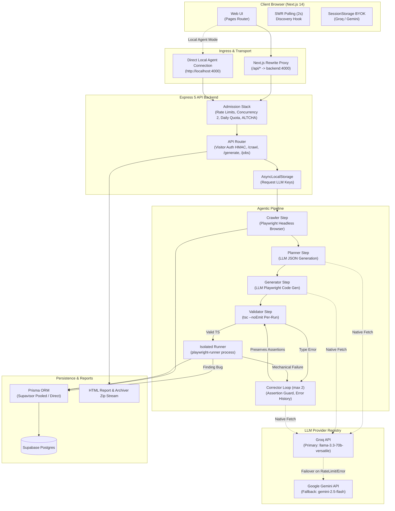

# Agentic Test Case Generator

An autonomous QA engineer agent that converts running web applications into resilient, self-healing Playwright TypeScript test suites. Given a target URL, the agent crawls live DOM state, synthesizes a structured user-journey test plan, generates typed Playwright test specifications, statically typechecks them, executes them in an isolated browser runner, and iteratively self-corrects mechanical failures (locators and timeouts) while preserving assertions and flagging genuine application bugs. Generated test runs are exposed via an interactive Next.js dashboard, downloadable as self-contained HTML reports with syntax-highlighted code and attempt diffs, and streamed as executable, production-ready Playwright repositories.

Portfolio & Production Status: Fully functional portfolio project and architecture reference implementation running on free-tier infrastructure (Express 5, Prisma, Supabase Postgres, Next.js 14, Playwright, Groq, and Gemini).

## What It Does

The core pipeline operates on an **Observe &rarr; Plan &rarr; Act &rarr; Reflect** agentic loop:

- **DOM Observation**: Launches a headless Playwright browser against the target URL, extracts interactive form controls, links, and buttons, infers semantic form boundaries, and outputs an `AppMap` with Playwright locator hierarchies (`getByTestId`, `getByRole`, `getByPlaceholder`, `getByLabel`, `getByText`, `css`).
- **Plan Synthesis**: Generates a strictly structured, JSON-schema-validated `TestPlan` defining critical user paths. Node.js assigns authoritative `tc-N` identifiers (LLM identifiers are never trusted).
- **Test Generation**: Generates clean, production-grade `@playwright/test` TypeScript specifications scoped strictly to interactive elements detected on the page.
- **Static Type Validation**: Runs `tsc --noEmit` within a dedicated runner scope before launching a browser, catching syntax and type errors without wasting browser runtime.
- **Isolated Execution**: Executes tests inside a decoupled runner environment (`playwright-runner`), capturing Playwright JSON report telemetry, attempt durations, step traces, and error outputs.
- **Triage & Classification**: Classifies test failures into a strict 4-part taxonomy: `finding` (actual app defect or assertion failure), `locator` (mismatched selector), `timeout` (timing/network lag), or `other` (runner crashes).
- **Self-Correction Guardrails**: Tests with mechanical failures (`locator`, `timeout`) enter a self-correction loop capped at 2 attempts. Corrections are strictly gated by an AST assertion guard that rejects any LLM output that weakens, alters, or removes `expect()` assertions. Genuine application defects (`finding`) are never corrected—they are preserved as authentic bug findings.
- **Deliverables**: Persists step-by-step agent telemetry to Supabase Postgres, produces an interactive Next.js dashboard with Monaco diff viewer, streams runnable ZIP archives, and compiles self-contained, offline-renderable HTML reports.

## System Architecture



### Synchronous Pipeline Architecture & Planned Evolution

Currently, `POST /api/generate` runs synchronously: the HTTP connection stays open while the agent crawls, plans, generates, validates, and executes tests across 30 to 120 seconds. Because Node.js creates the `Job` record in PostgreSQL immediately upon pipeline entry, the frontend initiates client-side SWR polling against `GET /api/jobs?page=1&limit=5` every 2 seconds to discover the active job ID and transition into real-time step streaming. Once discovered, the UI switches to polling `GET /api/jobs/:id` every 2 seconds until terminal completion. Moving from this synchronous hold to an asynchronous `202 Accepted` + Server-Sent Events (SSE) streaming architecture is the planned Phase 8 evolution.

## Repository Layout

| Path | Purpose | Architectural Rationale |
|---|---|---|
| `backend/` | Express 5 REST API, agent pipeline, crawler, LLM client, Prisma schema | Central agent intelligence and execution backend. Owns DB persistence, rate limiting, and runner orchestration. |
| `backend/src/agent/` | Agentic loop steps (`planner`, `generator`, `corrector`), prompts, cost & confidence calculators | Isolated agent reasoning modules. Prompts and step functions are cleanly decoupled from HTTP routes. |
| `backend/src/crawler/` | Playwright DOM extraction and AppMap synthesis | Headless browser crawler extracting interactive elements with normalized locator priority. |
| `backend/src/llm/` | Provider registry, native fetch client, AsyncLocalStorage key context | Zero-SDK LLM abstraction layer with automatic fallback, backoff, and per-request BYOK overrides. |
| `backend/src/runner/` | Static typecheck (`validate`) and test execution (`execute`) orchestrator | Spawns isolated Playwright child processes and translates test execution results into failure taxonomy. |
| `backend/src/security/` | Concurrency gate, signed visitor tokens, daily quota reservations, ALTCHA PoW | Multi-tiered abuse mitigation stack protecting free-tier deployment limits. |
| `backend/playwright-runner/` | Isolated Playwright test harness package | Decoupled from backend runtime dependencies. Has its own `package.json`, `tsconfig.json`, and `@playwright/test` runtime. Prevents test execution crashes or test dependency leaks from affecting the backend process. |
| `backend/scratch/` | Verified offline regression test suites (`testPhase6.ts`, `testPhase7A.ts`) | Permanent offline assertions testing algorithms, math, schemas, token parsing, and quota concurrency without live DB/LLM connections. |
| `frontend/` | Next.js 14 Pages Router web application | Dark-first developer dashboard. Communicates with backend via Next.js proxy rewrites or direct localhost calls. |

## Backend Architecture

### Runtime & Framework
- **Stack**: Node.js 20+, Express 5, TypeScript strict ESM (`.ts` import extensions).
- **Implementation**: Located in `backend/src/index.ts` and `backend/src/config.ts`.
- **Rationale**: Express 5 provides native Promise-rejection handling in route handlers, eliminating unhandled rejection wrappers. Strict TypeScript ESM ensures module boundary integrity. All environment variables are validated at startup via Zod in `backend/src/config.ts`.
- **Alternatives Considered**: Fastify (faster, but unnecessary plugin abstraction overhead for a dedicated API service); NestJS (excessive OOP ceremony and decorator magic); plain `node:http` (insufficient built-in routing and middleware ecosystem).

### Error Contract
- **Stack**: Domain error hierarchy extending native `Error`, with centralized mapping to HTTP status codes.
- **Implementation**: Defined in `backend/src/api/errors.ts` (`AppError`, `CrawlerError`, `ValidationError`, `RunnerError`, `LlmError`, `JobError`).
- **Envelope**: All non-2xx responses strictly adhere to:
  ```json
  {
    "error": "ERROR_CODE",
    "message": "Human-readable explanation.",
    "details": {}
  }
  ```
- **Rationale**: Prevents internal stack traces or Prisma driver anomalies from leaking to the client while giving the frontend structured error codes for conditional UI states.

### Crawler
- **Stack**: Playwright (`chromium.launch({ headless: true })`).
- **Implementation**: `backend/src/crawler/pageCrawler.ts`.
- **Mechanism**: Navigates to target URL with `networkidle` settling. Evaluates DOM in-browser to identify interactive elements (inputs, buttons, select, textarea, links, role triggers). Extracts selector maps ordered by Playwright best-practice priority (`getByTestId` &gt; `getByRole` &gt; `getByPlaceholder` &gt; `getByLabel` &gt; `getByText` &gt; `css`).
- **The `__name`/tsx Landmine**: In-browser Playwright evaluations strip function names when bundled with `tsx`/`esbuild`. DOM evaluation logic avoids relying on constructor names or minified helper identifiers.
- **Alternatives Considered**: Puppeteer (inferior locator ergonomics); Raw CDP (unnecessary protocol-level complexity).

### LLM Layer
- **Stack**: Native Node.js `fetch` (zero third-party SDKs), `AsyncLocalStorage` request-level overrides.
- **Implementation**: `backend/src/llm/client.ts`, `backend/src/llm/providers/`, `backend/src/llm/requestKeys.ts`.
- **Fallback Registry**: Provider registry defaults to Groq (`llama-3.3-70b-versatile`) as primary, failing over to Google Gemini (`gemini-2.5-flash`) on 429, 500, 503, or network timeout.
- **Smart Failover**: If Groq returns HTTP 429 with `retry-after > 10,000ms`, the client immediately breaks to Gemini rather than burning retry budgets against long TPM-reservation windows.
- **Token Limits**: Groq's `max_tokens` applies to total generation (including internal reasoning tokens). Prompts explicitly enforce concise outputs to prevent fence cutoff.
- **BYOK via ALS**: Request headers `x-groq-api-key` and `x-gemini-api-key` are bound to the execution fiber via `AsyncLocalStorage`. If present, calls use the visitor's keys, completely bypassing server-level rate limits and daily quotas.
- **Alternatives Considered**: LangChain / LlamaIndex (rejected: heavy abstractions obscure retry backoffs, provider fallbacks, and ALS key bindings); official SDKs (rejected: differing interfaces prevent uniform failover and telemetry capture).

### Agent Steps
- **Planner** (`backend/src/agent/steps/planner.ts`): Emits a strict JSON plan matching `TestPlanSchema`. Evaluates application scope and outputs high-value user journeys. Node assigns authoritative `tc-1`, `tc-2` IDs.
- **Generator** (`backend/src/agent/steps/generator.ts`): Slices `ScopedElement` definitions to provide the LLM with only the relevant elements for each test case, saving prompt tokens and avoiding context saturation.
- **Corrector** (`backend/src/agent/steps/corrector.ts`): Feeds failing code, error output, available page locators, and previous failed attempts into the corrector prompt (`correctorPrompt.ts`). Changes are validated through `correctionPreservesAssertions` in `assertionGuard.ts`, which rejects assertion weakening.

### Runner & Sandbox Isolation
- **Stack**: Subprocess runner executing in `backend/playwright-runner/`.
- **Implementation**: `backend/src/runner/validator.ts` and `backend/src/runner/executor.ts`.
- **Pre-flight TypeScript Gate**: Runs `tsc --noEmit` against a per-run scoped `tsconfig.json`. Syntactically invalid code is rejected before launching Chromium.
- **Failure Classification**: Parses Playwright JSON output into `finding` (assertion failure), `locator` (locator resolved 0 or &gt;1 elements), `timeout` (navigation or element timeout), or `other` (crash). Findings immediately terminate the test case without entering the corrector loop.

### Pipeline Orchestration
- **Stack**: Sequential per-test loop with atomic phase state transitions.
- **Implementation**: `backend/src/agent/pipeline.ts`.
- **Safe Database Writes**: State transitions use `safeWrite()`: if a database write fails due to transient connection drops or pooling saturation, the error is logged but the in-flight pipeline continues uninterrupted.

### Persistence
- **Stack**: Prisma 5 with PostgreSQL (Supabase).
- **Implementation**: `backend/prisma/schema.prisma`, `backend/src/db/`.
- **Dual URLs**: Uses Supavisor transaction pooler on port 6543 (`DATABASE_URL`) for runtime queries with connection limits, and direct connection on port 5432 (`DIRECT_URL`) for schema migrations.
- **Thin Repository**: Domain queries are encapsulated in `backend/src/db/jobs.ts`. Transactions are reserved for atomic test and execution result batch writes.
- **Alternatives Considered**: Drizzle (immature migration tooling with Supavisor at inception); TypeORM (cumbersome Active Record / Data Mapper hybrid); Raw SQL (lacks automatic type inference across relations).

### Admission & Security Stack
- **Visitor Tokens**: Minted as `<uuid>.<hmac-sha256>`. Legacy or tampered tokens are silently replaced with fresh identities.
- **Capability UUIDs**: Job list routes (`GET /api/jobs`) filter strictly by `req.visitorId`. Detail routes (`GET /api/jobs/:id`), HTML reports, and ZIP exports use unguessable capability UUIDs.
- **Rate Limits**: `express-rate-limit` enforces IP-level windows (generate: 3/hr; crawl: 10/hr; challenge: 30/hr; byok-validate: 10/hr) and visitor daily limits (5/day).
- **Concurrency Semaphore**: `ConcurrencyGate(2)` caps active pipeline executions at 2 to preserve the 512MB RAM ceiling on free-tier hosting (Chromium consumes ~150-200MB per instance).
- **Daily Quota & Atomic Reservations**: Global ceiling of 20 runs/day. In-flight runs reserve quota atomically via `tryReserve()` in `dailyQuota.ts` to prevent TOCTOU concurrency races. Reservations are released in a `finally` block upon completion.
- **ALTCHA Proof-of-Work**: Self-hosted proof-of-work challenge verified via HMAC SHA-256 with 5-minute expiry and in-memory replay prevention (10-minute cache). Bypasses third-party tracking, captcha forms, and paid Cloudflare Turnstile dependencies.
- **Retention**: Scheduled maintenance script `backend/src/maintenance/expireOldJobs.ts` purges job rows and cascading children older than 180 days (`RETENTION_DAYS`), preserving seeded sample IDs (`SAMPLE_JOB_IDS`).

### Deliverables
- **Self-Contained HTML Report**: Generated in `backend/src/report/htmlReport.ts`. Inlines Prism syntax highlighting CSS/JS and visual diff blocks into a single portable HTML file without external CDN dependencies.
- **ZIP Export**: Streamed on-the-fly in `backend/src/api/jobsRoutes.ts` using `archiver`. Compiles generated specs, `playwright.config.ts`, `package.json`, and instructions directly to the HTTP response stream without writing temporary disk archives.

### Compute-on-Read Metrics
- **Lifetime Stats**: Cached in-memory for 60 seconds (`GET /api/stats`).
- **Cost Estimation**: Aggregates token usage from `AgentStep` records and computes pricing dynamically using model rates defined in `backend/src/agent/costEstimate.ts`.
- **Confidence Scoring**: Heuristic algorithm (`backend/src/agent/confidence.ts`) calculates 0-100 scores and confidence bands (`high`, `medium`, `low`) at query time from code length, locator specificity, assertions, and attempt counts. Avoids stale DB schema migrations when heuristics evolve.

## Frontend Architecture

- **Framework**: Next.js 14 Pages Router (`pages/index.tsx`, `pages/jobs/index.tsx`, `pages/jobs/[id].tsx`, `pages/privacy.tsx`, `pages/404.tsx`).
- **Styling**: Tailwind CSS with curated design tokens, elevated surface layers, dark-first color schemes, and `@phosphor-icons/react` controls.
- **State & Data Fetching**: Local state via `useState`/`useReducer`. SWR handles caching and 2-second background polling, automatically pausing when a job reaches terminal status (`completed` or `failed`).
- **Job Discovery Pattern**: To handle the synchronous generation request, SWR polls recent jobs to discover the in-progress `jobId`, seamlessly streaming live timeline steps while the initial POST completes.
- **Editor & Diffs**: Monaco Editor loaded dynamically (`ssr: false`) in `CodeViewer.tsx` and `DiffViewer.tsx`, rendering read-only TypeScript specs and step attempt diffs.
- **Form Management**: `react-hook-form` coupled with Zod validation (`validation.ts`).
- **Accessibility & Polish**: Fully navigable via keyboard (`Cmd/Ctrl+K` shortcut to focus URL bar), accessible ARIA alerts, Sonner toast notifications, and `prefers-reduced-motion` detection in animated counters.

## Localhost & Deployment Modes

Hosted cloud servers cannot access a user's `localhost` directly. The application provides three distinct operational modes:

| Mode | Target URL | How It Works | Constraints & Caveats |
|---|---|---|---|
| **Hosted Demo** | Public HTTPS (`https://myapp.com`) | Hosted crawler visits target directly over public internet. | Cannot reach `localhost` or private subnets. |
| **Tunnel Mode** (Guided) | Public Tunnel (`*.trycloudflare.com`, `*.ngrok-free.app`) | Visitor runs `cloudflared tunnel --url http://localhost:<port>`. The hosted crawler connects through Cloudflare's temporary public tunnel. | Tunnel URLs expire when terminal is closed. Security warning displayed: do not tunnel apps with real credentials. |
| **Local Agent Mode** | `http://localhost:<port>` | Visitor runs backend locally (`pnpm dev` on port 4000 with `LOCAL_AGENT_MODE=true`). Frontend switches API base from Next.js proxy to direct `http://localhost:4000`. | Requires local backend setup. Subject to browser Private Network Access permissions. |

## API Reference

All requests accept and return JSON unless otherwise noted.

| Method | Endpoint | Request Payload / Headers | Success Response | Error Codes | Guards & Rate Limits |
|---|---|---|---|---|---|
| `GET` | `/api/health` | None | `{ status: 'ok', timestamp, llmConfigured: boolean }` | None | Public, unthrottled |
| `GET` | `/api/stats` | None | `{ jobsRun, testCasesGenerated, testsPassed, correctionsApplied, updatedAt }` | `500 INTERNAL_ERROR` | Cached 60s in-memory |
| `GET` | `/api/pow/challenge` | None | `{ algorithm, challenge, maxnumber, salt, signature }` | `500 INTERNAL_ERROR` | Rate limit: 30/hr per IP |
| `POST` | `/api/crawl` | `{ url: string }` | `AppMap` (elements, forms, viewport) | `400 INVALID_REQUEST`<br>`500 CRAWL_FAILED` | Rate limit: 10/hr per IP |
| `POST` | `/api/byok/validate` | `{ provider: 'groq' \| 'gemini' }`<br>`x-groq-api-key` or `x-gemini-api-key` | `{ valid: boolean, reason?: string }` | `400 INVALID_REQUEST` | Rate limit: 10/hr per IP |
| `POST` | `/api/generate` | Single: `{ url: string, altcha?: string }`<br>Batch: `{ urls: string[], altcha?: string }`<br>Optional: `x-groq-api-key`, `x-gemini-api-key` | Single: `PipelineResult`<br>Batch: `BatchResponse` | `400 INVALID_REQUEST`<br>`400 POW_FAILED`<br>`429 DAILY_QUOTA_EXHAUSTED`<br>`429 QUEUE_FULL`<br>`429 RATE_LIMITED` | IP limit: 3/hr<br>Visitor limit: 5/day<br>Concurrency limit: 2<br>Daily quota: 20/day (bypassed if BYOK) |
| `GET` | `/api/jobs` | Query: `?page=1&limit=10`<br>Header: `X-Visitor-Id` | `JobsListResponse` (scoped to visitor) | `400 INVALID_QUERY` | Visitor-scoped |
| `GET` | `/api/jobs/:id` | Param: `id` (UUID) | `JobDetail` (job, steps, tests, cost) | `404 JOB_NOT_FOUND` | Capability UUID lookup |
| `GET` | `/api/jobs/:id/report.html` | Param: `id` (UUID) | HTML Document (`text/html`) | `404 JOB_NOT_FOUND`<br>`409 REPORT_NOT_READY` | Capability UUID lookup |
| `GET` | `/api/jobs/:id/export.zip` | Param: `id` (UUID) | Binary Stream (`application/zip`) | `404 JOB_NOT_FOUND`<br>`409 EXPORT_NOT_READY` | Capability UUID lookup |

### Header Contracts
- `X-Visitor-Id`: Token in `<uuid>.<hmac-sha256>` format. If missing or invalid, server mints a new identity and sets `x-visitor-id` in response headers. Client persists in `localStorage['atsg-visitor-id']`.
- `x-groq-api-key` / `x-gemini-api-key`: Provided by visitor for BYOK runs. Evaluated via `AsyncLocalStorage`. Never logged, never persisted to disk or database.

## Data Model

```
 ┌────────────────────────────────────────────────────────┐
 │                         Job                            │
 ├────────────────────────────────────────────────────────┤
 │ id: Uuid PK                                            │
 │ targetUrl: String                                      │
 │ status: JobStatus (pending..completed/failed)          │
 │ errorCode / errorMessage: String?                      │
 │ appMap / testPlan: Json?                               │
 │ createdAt / startedAt / completedAt: DateTime          │
 │ visitorId: String? (indexed)                           │
 │ usedOwnKeys: Boolean (@default false)                  │
 └──────────────────────────┬─────────────────────────────┘
                            │ 1:N (onDelete: Cascade)
           ┌────────────────┴────────────────┐
           ▼                                 ▼
 ┌──────────────────────────┐      ┌──────────────────────────┐
 │        AgentStep         │      │      GeneratedTest       │
 ├──────────────────────────┤      ├──────────────────────────┤
 │ id: Uuid PK              │      │ id: Uuid PK              │
 │ jobId: Uuid FK           │      │ jobId: Uuid FK           │
 │ stepType: StepType       │      │ testCaseId: String       │
 │ testCaseId: String?      │      │ filename: String         │
 │ attemptNumber: Int?      │      │ finalCode: String        │
 │ status: StepStatus       │      │ finalStatus: TestStatus  │
 │ latencyMs: Int?          │      │ totalAttempts: Int       │
 │ llmProvider / llmModel   │      │ createdAt: DateTime      │
 │ prompt / completionTokens│      └────────────┬─────────────┘
 │ errorDetail: String?     │                   │ 1:N (onDelete: Cascade)
 │ createdAt: DateTime      │                   ▼
 └──────────────────────────┘      ┌──────────────────────────┐
                                   │     ExecutionResult      │
                                   ├──────────────────────────┤
                                   │ id: Uuid PK              │
                                   │ generatedTestId: Uuid FK │
                                   │ attemptNumber: Int       │
                                   │ code: String             │
                                   │ validationPassed: Bool   │
                                   │ validationErrors: Str[]  │
                                   │ executionPassed: Bool    │
                                   │ executionError: String?  │
                                   │ failureClass: FailClass? │
                                   │ durationMs: Int?         │
                                   │ corrected: Boolean       │
                                   │ createdAt: DateTime      │
                                   └──────────────────────────┘
```

- **Enums**:
  - `JobStatus`: `pending`, `crawling`, `planning`, `generating`, `executing`, `completed`, `failed`
  - `StepType`: `crawl`, `plan`, `generate`, `validate`, `execute`, `correct`
  - `StepStatus`: `success`, `failure`
  - `TestStatus`: `passed`, `failed`, `gave_up`
  - `FailureClass`: `finding`, `locator`, `timeout`, `other`
- **Cascading Deletes**: Purging a `Job` automatically purges all related `AgentStep`, `GeneratedTest`, and `ExecutionResult` rows.

## Key Design Decisions

| Decision | Chosen | Why | Alternatives Rejected / Deferred |
|---|---|---|---|
| **ORM** | Prisma 5 | Clean TypeScript client generation and relation typing. | Drizzle (connection pooler quirks with Supavisor); TypeORM (verbose decorators). |
| **Connection Pooling** | Supavisor (Port 6543) + Direct (5432) | Prevents Postgres connection exhaustion on serverless/container spikes while retaining migration capability. | Single direct connection (crashed on concurrent spikes). |
| **LLM Integration** | Native Node `fetch` + `AsyncLocalStorage` | Complete control over retry backoffs, headers, provider failovers, and BYOK token passing. | LangChain / SDKs (hide error codes, inflexible fallback logic, high overhead). |
| **Primary Keys** | UUID v4 | Prevents predictable resource enumeration attacks and allows capability-URL sharing without authorization middleware. | Integer auto-increment (trivial sequential scraping vulnerability). |
| **Visitor Sessions** | Server-Signed HMAC Tokens | Frictionless, zero-login visitor tracking stored in `localStorage`. | GitHub OAuth / Passwords (unnecessary barrier for a public developer tool). |
| **Abuse Protection** | ALTCHA Proof-of-Work | Free, MIT-licensed, privacy-preserving, zero external account or Cloudflare lock-in. | Cloudflare Turnstile / reCAPTCHA (requires corporate accounts and third-party script injection). |
| **Rate Limiting** | In-Memory (`express-rate-limit`) | Zero infrastructure overhead for single-instance container deployment. | Redis (unnecessary operational cost for single-node free tier). |
| **Cost & Confidence** | Compute-on-read | Allows pricing rates and confidence heuristics to be updated without running retrofitting DB migrations. | Stored DB columns (creates stale historical scores when algorithms improve). |
| **ZIP Packaging** | In-memory `archiver` streaming | Zero temporary disk footprint; streaming starts immediately. | Writing temp ZIPs to disk (disk leaks and cleanup race hazards). |
| **Sandbox Execution** | Decoupled `playwright-runner` package | Isolates Playwright dependencies and config from backend server dependencies. | Running tests in backend process (test runner crashes kill the web server). |
| **Failure Triage** | Strict 4-tier taxonomy (`finding`, `locator`, `timeout`, `other`) | Distinguishes actual bugs from flaky locators, preventing tests from masking real bugs. | Binary pass/fail (causes corrector to rewrite assertions on genuine application defects). |
| **Frontend Framework** | Next.js 14 Pages Router | Mature, reliable SSR and API rewrites without App Router client/server boundary instability. | Next.js App Router (turbopack/RSC complexity); Vite SPA (lacks SSR and clean proxy rewrites). |
| **Frontend State** | React `useReducer` + SWR | Simple, resilient state machine with built-in cache revalidation and polling termination. | Redux / Zustand (overkill for page-scoped state transitions). |

## Cost & Quota Model

- **Measured Token Consumption**: A representative single-page run (e.g., TodoMVC) averages ~14,500 total tokens across planning, generation, validation, and correction steps (~10,800 prompt tokens, ~3,700 completion tokens).
- **Inference Cost**: At Groq list prices for `llama-3.3-70b-versatile` ($0.59/1M prompt, $0.79/1M completion), a standard run costs approximately **$0.009** (or free on Groq's developer tier).
- **Free-Tier Limits**:
  - Groq free tier imposes 1,000 requests per day (RPD) and a 30,000 TPM rate limit.
  - Gemini free tier provides variable burst capacity with tighter daily quotas.
- **Global Daily Cap**: To guarantee 100% availability on free tiers without budget exhaustion, the public server caps unauthenticated runs at **20 runs per UTC day**.
- **BYOK Exemption**: Visitors providing their own Groq or Gemini API keys bypass the global daily quota entirely, as costs are billed directly to their personal provider allocations.

## Local Development

### Prerequisites
- Node.js 20+
- `pnpm` (`corepack enable && corepack prepare pnpm@latest --activate`)
- PostgreSQL instance (local or Supabase)

### Backend Setup

```powershell
cd backend
pnpm install
npx playwright install chromium

# Copy environment template
Copy-Item .env.example .env

# Generate Prisma Client & Run Migrations
pnpm exec prisma migrate dev

# Run verification test suites
pnpm exec tsx scratch/testPhase6.ts
pnpm exec tsx scratch/testPhase7A.ts

# Start development server on http://localhost:4000
pnpm dev
```

### Frontend Setup

```powershell
cd frontend
pnpm install

# Copy environment template
Copy-Item .env.example .env.local

# Start Next.js development server on http://localhost:3000
pnpm dev
```

### Environment Variables

#### Backend (`backend/.env`)

| Variable | Required | Default | Purpose |
|---|---|---|---|
| `PORT` | No | `4000` | Port for Express API server |
| `NODE_ENV` | No | `development` | Environment mode (`development`, `production`, `test`) |
| `HEADLESS` | No | `false` | Run Playwright in headless mode |
| `MAX_ELEMENTS_PER_PAGE` | No | `200` | DOM element extraction limit |
| `NAVIGATION_TIMEOUT_MS` | No | `30000` | Playwright page load timeout |
| `NETWORK_IDLE_WAIT_MS` | No | `3000` | Network settling idle duration |
| `DATABASE_URL` | **Yes** | — | Supavisor pooled PostgreSQL connection string |
| `DIRECT_URL` | **Yes** | — | Direct PostgreSQL connection string for Prisma migrations |
| `GROQ_API_KEY` | Optional* | — | Server-level Groq API key (*at least one provider key recommended) |
| `GEMINI_API_KEY` | Optional* | — | Server-level Google Gemini API key |
| `POW_SECRET` | No | — | Secret key for ALTCHA challenge signing (min 16 chars) |
| `VISITOR_SIGNING_SECRET`| No | — | Secret key for visitor token HMAC signing (min 16 chars) |
| `GENERATE_DAILY_LIMIT` | No | `20` | Daily global quota limit for unauthenticated runs |
| `LOCAL_AGENT_MODE` | No | `false` | Enable permissive CORS/PNA headers for local agent connections |
| `TRUST_PROXY_HOPS` | No | `1` | Number of upstream reverse proxies for IP extraction |
| `FRONTEND_ORIGIN` | No | — | Allowed origin URL for local agent mode CORS reflection |

#### Frontend (`frontend/.env.local`)

| Variable | Required | Default | Purpose |
|---|---|---|---|
| `BACKEND_URL` | No | `http://localhost:4000` | Target URL for Next.js API rewrite proxy |
| `NEXT_PUBLIC_SITE_URL`| No | `http://localhost:3000` | Canonical site URL for SEO meta and JSON-LD schema |
| `NEXT_PUBLIC_GA_ID` | No | — | Google Analytics tracking ID |
| `NEXT_PUBLIC_GSC_VERIFICATION` | No | — | Google Search Console verification token |

### Quality Gates

```powershell
# Typecheck backend
cd backend; pnpm run typecheck

# Typecheck frontend
cd frontend; pnpm run typecheck

# Production build frontend
cd frontend; pnpm run build
```

## Limitations & Known Trade-offs

- **Synchronous POST Latency**: Because generating, validating, executing, and correcting tests takes 30-120 seconds, HTTP proxies with aggressive 30-second timeouts (like Cloudflare free edge) can disconnect during runs. Mitigated by SWR background polling and planned for replacement with SSE.
- **Localhost Accessibility**: Deployed cloud servers cannot access private LANs or `localhost`. Requires Cloudflare Quick Tunnel or Local Agent mode.
- **Cold Boot Latency**: Free-tier hosting providers (such as Render) spin down inactive instances, leading to 30-50 second cold-start delays on initial requests.
- **Anonymous Sessions**: Job history relies on browser `localStorage` visitor tokens; clearing site data detaches past run history (though runs remain accessible via direct UUID links).
- **SSRF Hardening**: The hosted crawler operates with broad public-web access; strict IP blacklisting and private subnet blocking are deployment-dependent.

## Roadmap (Planned)

- **Planned**: Asynchronous pipeline architecture returning `202 Accepted` with a `jobId` immediately, replacing synchronous HTTP holds.
- **Planned**: Server-Sent Events (SSE) streaming real-time agent thought logs, DOM snapshots, and validation traces directly to the client.
- **Planned**: SSRF protection middleware blocking crawler access to internal metadata endpoints (`169.254.169.254`, private RFC1918 subnets) in hosted environments.
- **Planned**: Standalone companion CLI tool (`npx atsg crawl`) executing tests locally and synchronizing reports to the cloud dashboard.
- **Planned**: Secret-gated public job sharing links with granular read-only capability tokens.
