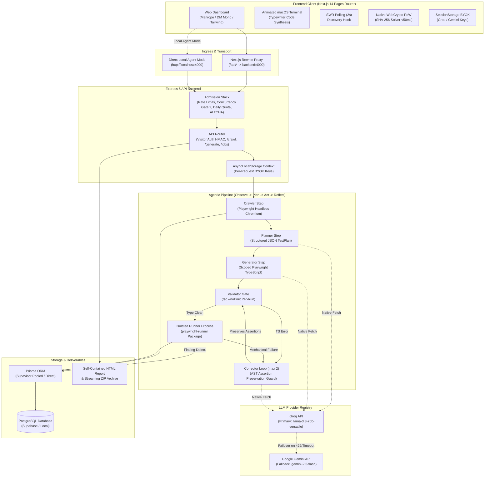

# Agentic Test Case Generator

<div align="center">

[](https://www.typescriptlang.org/)
[-black.svg?style=flat-square&logo=next.js)](https://nextjs.org/)
[](https://expressjs.com/)
[](https://playwright.dev/)
[](https://www.prisma.io/)
[](https://tailwindcss.com/)
[](https://groq.com/)
[](https://opensource.org/licenses/MIT)

**An autonomous AI QA engineering agent that observes live web applications and synthesizes robust, self-healing Playwright TypeScript test suites grounded in real DOM evidence.**

[Live Demo](http://localhost:3000) • [Architecture](#system-architecture) • [API Reference](#api-reference) • [Design Lab](#how-it-works-design-exploration-lab) • [Local Setup](#local-development)

</div>

---

## Table of Contents

- [Overview](#overview)
- [What It Does](#what-it-does)
- [System Architecture](#system-architecture)
- [Repository Structure](#repository-structure)
- [Core Agent Pipeline](#core-agent-pipeline)
  - [1. DOM Observation & Crawling](#1-dom-observation--crawling)
  - [2. Journey Plan Synthesis](#2-journey-plan-synthesis)
  - [3. Playwright Code Generation](#3-playwright-code-generation)
  - [4. Static TypeScript Pre-flight Gate](#4-static-typescript-pre-flight-gate)
  - [5. Isolated Execution & Triage](#5-isolated-execution--triage)
  - [6. Self-Correction & Assertion Preservation Guard](#6-self-correction--assertion-preservation-guard)
- [Security & Admission Stack](#security--admission-stack)
  - [Native Web Crypto Proof-of-Work (ALTCHA)](#native-web-crypto-proof-of-work-altcha)
  - [Visitor Authentication & Capability UUIDs](#visitor-authentication--capability-uuids)
  - [Concurrency Semaphores & Atomic Quotas](#concurrency-semaphores--atomic-quotas)
  - [Zero-SDK BYOK Isolation (AsyncLocalStorage)](#zero-sdk-byok-isolation-asynclocalstorage)
- [How It Works: Design Exploration Lab (11 Patterns)](#how-it-works-design-exploration-lab)
- [Localhost & Deployment Modes](#localhost--deployment-modes)
- [API Reference](#api-reference)
- [Data Model & Prisma Schema](#data-model--prisma-schema)
- [Local Development Setup](#local-development)
  - [Prerequisites](#prerequisites)
  - [Backend Setup](#backend-setup)
  - [Frontend Setup](#frontend-setup)
  - [Environment Variables](#environment-variables)
- [Verification & Quality Gates](#verification--quality-gates)
- [Measured Token Economics](#measured-token-economics)
- [License](#license)

---

## Overview

Writing and maintaining browser end-to-end tests is historically brittle and time-consuming. Selectors change, asynchronous hydration triggers race conditions, and teams spend hours updating assertions after minor UI refactors.

**Agentic Test Case Generator** replaces manual test authoring with an autonomous QA agent. Given any accessible web application URL, the agent:
1. Navigates with a headless Chromium browser and catalogs real interactive elements.
2. Derives realistic user journeys strictly grounded in the discovered DOM.
3. Synthesizes typed, idiomatic `@playwright/test` specifications without hallucinating CSS or XPath selectors.
4. Pre-compiles the code with `tsc --noEmit` before executing in an isolated runner sandbox.
5. Triages browser execution errors into **Real Application Defects** (which are never masked) versus **Mechanical Flakiness** (which the agent heals in a guarded loop).

---

## What It Does

```
 ┌────────────────┐      ┌────────────────┐      ┌────────────────┐      ┌────────────────┐      ┌────────────────┐
 │   1. CRAWL     │ ───► │    2. PLAN     │ ───► │  3. GENERATE   │ ───► │  4. VALIDATE   │ ───► │  5. HEAL/FLAG  │
 │ Live DOM Trees │      │ User Journeys  │      │ Playwright TS  │      │  tsc --noEmit  │      │ Guarded Loop   │
 └────────────────┘      └────────────────┘      └────────────────┘      └────────────────┘      └────────────────┘
```

- **Zero Selector Guessing**: Locators are resolved strictly against actual DOM accessibility trees (`getByRole`, `getByLabel`, `getByPlaceholder`, `getByTestId`, `getByText`).
- **Assertion Preservation Guard**: Real defects and failed assertions are preserved as authentic findings. The agent is strictly prevented from rewriting or weakening test assertions to force a "green" pass.
- **Self-Healing Automation**: Flaky selectors and DOM timing issues are diagnosed using browser stderr and retried with corrected locators (capped at 2 attempts).
- **Interactive UI Dashboard**: Dark-first Next.js interface with Monaco diff viewers, animated macOS execution terminal, live pipeline progress trackers, and instant export to self-contained HTML reports and `.zip` test repositories.
- **Free-Tier Resilient**: Zero external paid dependencies. Self-hosted Web Crypto Proof-of-Work, atomic concurrency semaphores, and smart failover between Groq (`Llama 3.3 70B`) and Google Gemini (`Gemini 2.5 Flash`).

---

## System Architecture



---

## Repository Structure

```text
agentic-test-generator/
├── backend/
│   ├── prisma/
│   │   ├── schema.prisma              # Data schema: Job, AgentStep, GeneratedTest, ExecutionResult
│   │   └── migrations/                # Version-controlled SQL migrations
│   ├── playwright-runner/             # Decoupled test execution harness (isolated package.json)
│   ├── scratch/                       # Offline regression & math test suites
│   │   ├── testPhase6.ts              # Full mock pipeline integration test
│   │   ├── testPhase7A.ts             # Quota reservation & concurrency test
│   │   ├── testAssertionGuard.ts      # AST assertion integrity verification
│   │   └── testRunnerIsolation.ts     # Process sandbox & timeout safety tests
│   ├── src/
│   │   ├── agent/                     # Pipeline steps (crawl, plan, codegen, validate, correct)
│   │   │   ├── confidence.ts          # Compute-on-read confidence scoring
│   │   │   ├── costEstimate.ts        # Dynamic token pricing calculations
│   │   │   ├── pipeline.ts            # Master agent orchestrator with safe DB writes
│   │   │   └── prompts/               # Structured system prompts & schemas
│   │   ├── api/                       # Express 5 REST routes, rate limits, error hierarchy
│   │   ├── crawler/                   # Playwright DOM extraction & AppMap synthesis
│   │   ├── db/                        # Prisma repository layer
│   │   ├── llm/                       # Native fetch LLM client, ALS context, Groq/Gemini failover
│   │   ├── report/                    # Self-contained HTML report compiler
│   │   ├── runner/                    # Static typecheck (tsc) & browser execution sandboxes
│   │   └── security/                  # PoW challenge signer, HMAC tokens, atomic quotas
│   └── package.json
│
├── frontend/
│   ├── components/
│   │   ├── code/                      # Monaco CodeViewer and DiffViewer
│   │   ├── common/                    # Seo, Nav, Footer, ErrorBoundary
│   │   ├── home/                      # UrlGenerateForm, CrawlPreview, PipelineProgress, PowWidget
│   │   │   ├── HeroTerminal.tsx       # Animated macOS code synthesis terminal
│   │   │   ├── HowItWorks.tsx         # Baseline execution loop & taxonomy
│   │   │   └── how-it-works-variants/ # 11 distinct creative architectural presentations
│   │   └── layout/                    # Header, ApiKeyModal, RootLayout
│   ├── hooks/                         # useJobPolling (SWR), useVisitorToken
│   ├── lib/                           # api.ts, targetUrl.ts, validation.ts
│   ├── pages/                         # Next.js Pages Router (/, /jobs, /jobs/[id], /privacy)
│   ├── styles/                        # globals.css (design tokens, animations, variants)
│   └── package.json
│
└── Readme.md                          # Comprehensive architecture & setup documentation
```

---

## Core Agent Pipeline

### 1. DOM Observation & Crawling
The crawler navigates to the target URL using headless Chromium, waiting for network idle. It evaluates the live DOM to discover interactive elements (inputs, buttons, dropdowns, links) and builds an `AppMap` with hierarchical Playwright locators ordered by robustness:
$$\text{getByTestId} \succ \text{getByRole} \succ \text{getByPlaceholder} \succ \text{getByLabel} \succ \text{getByText} \succ \text{css}$$

### 2. Journey Plan Synthesis
The Planner analyzes the `AppMap` and emits a structured `TestPlan` defining critical end-to-end user journeys. Authoritative `tc-N` identifiers are assigned by the server (never trusting LLM identifiers).

### 3. Playwright Code Generation
The Generator creates production-grade `@playwright/test` TypeScript specifications. Each test case is provided with a sliced view of only the relevant interactive elements, avoiding prompt context saturation and eliminating selector hallucinations.

### 4. Static TypeScript Pre-flight Gate
Before launching Chromium, the generated specification is validated with `tsc --noEmit` inside an isolated runner workspace. Syntax errors and type mismatches fail fast without consuming browser runtime.

### 5. Isolated Execution & Triage
Tests execute inside `backend/playwright-runner/` with strict process isolation and timeout safety. The runner classifies outcomes into a strict 4-part taxonomy:

| Classification | Meaning | Agent Action |
|---|---|---|
| **`finding`** | Assertion failure (`expect().toBe()`) or 500 server error | **Never corrected**. Preserved as an authentic application defect with screenshot evidence. |
| **`locator`** | Selector resolved 0 or >1 elements | Sent to Corrector with browser logs. |
| **`timeout`** | Navigation or DOM element timeout | Sent to Corrector with timing context. |
| **`other`** | Runner or browser crash | Marked as gave up. |

### 6. Self-Correction & Assertion Preservation Guard
Mechanical failures (`locator`, `timeout`) enter a guarded correction loop capped at 2 attempts. The corrected code must pass an AST assertion guard:
- All original `expect()` assertions must remain intact.
- Any generated code that deletes, comments out, or weakens an assertion to achieve a pass is strictly rejected.

---

## Security & Admission Stack

```
                          Incoming Request (POST /api/generate)
                                          │
                                          ▼
                         ┌─────────────────────────────────┐
                         │   IP Rate Limiter (3 req/hr)    │ ─── (Skipped if BYOK)
                         └─────────────────────────────────┘
                                          │ PASS
                                          ▼
                         ┌─────────────────────────────────┐
                         │    Visitor Limiter (5 runs/day) │ ─── (Skipped if BYOK)
                         └─────────────────────────────────┘
                                          │ PASS
                                          ▼
                         ┌─────────────────────────────────┐
                         │   ALTCHA Proof-of-Work Verifier │ ─── (HMAC SHA-256 + Replay Cache)
                         └─────────────────────────────────┘
                                          │ PASS
                                          ▼
                         ┌─────────────────────────────────┐
                         │  Daily Quota Reservation (20)   │ ─── (Atomic tryReserve)
                         └─────────────────────────────────┘
                                          │ PASS
                                          ▼
                         ┌─────────────────────────────────┐
                         │  Concurrency Semaphore (Gate 2) │ ─── (Protects 512MB RAM ceiling)
                         └─────────────────────────────────┘
                                          │ PASS
                                          ▼
                         [ Execute Agent Pipeline ]
```

### Native Web Crypto Proof-of-Work (ALTCHA)
- Bypasses corporate tracking, reCAPTCHAs, and paid Turnstile services.
- Backend issues HMAC-SHA-256 signed numeric challenges.
- Frontend solves the challenge via a high-speed native Web Crypto API worker in [`PowWidget.tsx`](frontend/components/home/PowWidget.tsx) (solving in <50ms without external library bugs).
- Verified solutions are cached in an in-memory replay table for 10 minutes.

### Visitor Authentication & Capability UUIDs
- Frictionless, zero-login sessions using signed HMAC tokens: `<uuid>.<hmac-sha256>` stored in `localStorage`.
- Tampered or legacy tokens are silently refreshed.
- Public job sharing and report downloads use unguessable capability UUIDs.

### Concurrency Semaphores & Atomic Quotas
- `ConcurrencyGate(PIPELINE_CONCURRENCY)` (default 2). One slot per run group; a run group executes its jobs sequentially, so at most N pipelines (one Chromium each) run at once. Pipelines run detached from the request; on shutdown in-flight jobs are marked `SERVER_SHUTDOWN`, and on boot any orphaned non-terminal job is marked `SERVER_RESTART`.
- Daily quotas (20 runs/day) use atomic reservations (`tryReserve()`) to eliminate Time-of-Check to Time-of-Use (TOCTOU) races.

### Zero-SDK BYOK Isolation (AsyncLocalStorage)
- Visitors can bring their own Groq or Gemini API keys.
- Keys are passed via `x-groq-api-key` / `x-gemini-api-key` headers and scoped to the active execution fiber via Node's `AsyncLocalStorage`.
- Keys bypass server quotas and are **never** logged or persisted to disk or database.

---

## How It Works: Design Exploration Lab

To explore diverse visual presentations, 11 distinct, fully styled, responsive design patterns have been built and rendered live on the homepage right below the original section:

```
  ┌────────────────────────────────────────────────────────────────────────────────────────┐
  │                           DESIGN EXPLORATION LAB (QUICK-JUMP)                          │
  │ [All 11] [01 Split] [02 Carousel] [03 Orbit] [04 Bento] [05 Nodes] [06 Deep-Dive] ... │
  └────────────────────────────────────────────────────────────────────────────────────────┘
```

1. **Variant 01 — Interactive Split Stepper**: Two-column layout with an interactive step timeline on the left and a live, copyable pipeline artifact viewer on the right (DOM JSON, journey markdown, Playwright TypeScript, `tsc` diagnostics).
2. **Variant 02 — Horizontal Glassmorphic Carousel**: Fluid horizontal slide deck with step counter (`01 / 05`), dynamic fill progress bar, glassmorphism cards, and large tactile navigation buttons.
3. **Variant 03 — Orbital Agentic Brain Loop**: Glowing central `AGENTIC CORE` with 5 peripheral satellite nodes connected by orbital paths. Clicking any node expands its technical mechanism.
4. **Variant 04 — Bento Grid Matrix**: Modern Apple/Linear style asymmetric grid with an interactive DOM chip selector, live TypeScript compiler terminal, and Assertion Guard indicators.
5. **Variant 05 — Node-Based Pipeline Dataflow**: Architecture diagram with glowing node connectors and an interactive I/O Contract inspector showing data transformations.
6. **Variant 06 — Tabbed Technical Deep-Dive**: Horizontal tab switcher with detailed specification tables (Discovery Depth, Locator Trees, Models) and code snippets.
7. **Variant 07 — 3D Isometric Layered Stack**: 3D perspective cards with hover elevation transforms, ambient glow shadows, and vertical flow indicators.
8. **Variant 08 — Terminal-Driven Storyboard CLI**: macOS terminal window with animated typewriter CLI prompts, stage timeline tabs, and execution controls (Play, Pause, Step Forward).
9. **Variant 09 — "Traditional QA vs Agentic Test" Matrix**: Side-by-side contrast grid detailing the differences in selector stability, authoring speed, maintenance overhead, and bug preservation.
10. **Variant 10 — Expandable Accordion Drawers**: Sleek, mobile-first vertical accordion list with animated chevron rotations and interactive micro-visualizers.
11. **Variant 11 — Interactive Execution Simulator Sandbox**: Live browser simulation sandbox. Click **"Run Simulated Suite"** to watch the agent crawl, generate tests, catch a flaky locator, self-correct it, and verify assertions with live progress bars.

---

## Localhost & Deployment Modes

| Mode | Target URL | How It Works | Requirements |
|---|---|---|---|
| **Hosted Demo** | Public HTTPS (`https://myapp.com`) | Hosted crawler visits target directly over the public internet. | Target must be publicly accessible. |
| **Tunnel Mode** | Public Tunnel (`*.trycloudflare.com`, `*.ngrok-free.app`) | User runs `cloudflared tunnel --url http://localhost:<port>`. The hosted crawler connects through Cloudflare's temporary tunnel. | No credentials required. Guided wizard included in the UI. |
| **Local Agent Mode** | `http://localhost:<port>` | User runs backend locally (`pnpm dev` on port 4000 with `LOCAL_AGENT_MODE=true`). Frontend switches API base directly to localhost. | Private Network Access enabled in browser. |

---

## API Reference

All endpoints accept and return JSON unless otherwise noted.

| Method | Endpoint | Request Payload / Headers | Description | Rate Limits |
|---|---|---|---|---|
| `GET` | `/api/health` | None | Service liveness and LLM configuration status | Unthrottled |
| `GET` | `/api/stats` | None | Global lifetime metrics (jobs, tests, pass rates) | Cached 60s in-memory |
| `GET` | `/api/pow/challenge` | None | Mint ALTCHA cryptographic PoW challenge | 30 req/hr per IP |
| `POST` | `/api/crawl` | `{ url: string }` | Crawl URL and return discovered `AppMap` | 10 req/hr per IP |
| `POST` | `/api/byok/validate` | `{ provider: 'groq' \| 'gemini' }`<br>`x-groq-api-key` or `x-gemini-api-key` | Validate personal API keys | 10 req/hr per IP |
| `POST` | `/api/generate` | Single URL: `{ url, deepCrawl?: boolean, webhookUrl?: string, altcha?: string }`<br>Multi URL: `{ urls: string[] (≤5), webhookUrl?: string, altcha?: string }`<br>Optional: BYOK headers | Admit a run group. Returns `202 { jobIds, webhookSecret? }` immediately; jobs run detached and sequentially | 3/hr IP, 5/day visitor, 20/day global (bypassed if BYOK) |
| `GET` | `/api/jobs` | Query: `?page=1&limit=10`<br>Header: `X-Visitor-Id` | List jobs scoped to active visitor token | Visitor-scoped |
| `GET` | `/api/jobs/:id` | Param: `id` (UUID) | Retrieve job details, agent steps, and tests | Capability UUID |
| `GET` | `/api/jobs/:id/stream` | Param: `id` (UUID) | SSE: snapshot → replay (Last-Event-ID) → live phase_change / step_recorded / test_completed / job_finished; 15s heartbeat; unavailable ⇒ poll | Capability UUID |
| `GET` | `/api/jobs/:id/report.html` | Param: `id` (UUID) | Download self-contained offline HTML report | Capability UUID |
| `GET` | `/api/jobs/:id/export.zip` | Param: `id` (UUID) | Stream executable Playwright repository ZIP | Capability UUID |

### Webhooks & Notifications

When `webhookUrl` is provided in `POST /api/generate`, the backend delivers a post-run HTTP notification upon job completion or failure.

- **Request**: `POST /api/generate` with `{ url, webhookUrl: "https://your-domain.com/webhook", deepCrawl?: boolean }`
- **Response**: `202 Accepted` returns `{ jobIds: [...], webhookSecret: string }`. The `webhookSecret` is returned **only once** and is never stored on disk.
- **SSRF Protection**: Private IPs, localhost, AWS metadata (`169.254.169.254`), and non-HTTPS endpoints (in non-local agent mode) are blocked.
- **Payload Shape**:
  ```json
  {
    "event": "job.finished",
    "jobId": "e0b8e8b0-...",
    "targetUrl": "https://example.com",
    "finishedAt": "2026-10-17T12:00:00.000Z",
    "status": "completed",
    "tests": {
      "total": 3,
      "passed": 3,
      "failed": 0,
      "gaveUp": 0
    }
  }
  ```
  *(Or if failed: `{ "status": "failed", "errorCode": "BROWSER_LAUNCH_FAILED" }`)*
- **Signature Verification**:
  Every webhook request includes an `X-Agentic-Signature` header computed as HMAC-SHA256 of the raw request body using the `webhookSecret`:
  ```ts
  const signature = req.headers['x-agentic-signature']; // "sha256=<hex>"
  const expected = 'sha256=' + crypto.createHmac('sha256', webhookSecret).update(rawBody).digest('hex');
  const isValid = crypto.timingSafeEqual(Buffer.from(signature), Buffer.from(expected));
  ```
- **Delivery Guarantees**: Requests timeout after 5 seconds with one automatic retry after 2 seconds on 5xx/429 errors. Webhook dispatch is non-blocking and never holds the pipeline concurrency gate.

### Deep Crawl Multi-Page Mode

- **Field**: `deepCrawl: true` (only valid for single-URL requests `{ url, deepCrawl: true }`).
- **Behavior**: The crawler starts at the target URL and discovers same-origin links (up to 3 pages total). Elements from extra pages are tagged with their source page number, enabling multi-page journey planning with explicit navigation steps.

---

## Data Model & Prisma Schema

```
  ┌────────────────────────────────────────────────────────┐
  │                         Job                            │
  ├────────────────────────────────────────────────────────┤
  │ id: Uuid (PK)                                          │
  │ targetUrl: String                                      │
  │ status: JobStatus (pending..completed/failed)          │
  │ errorCode / errorMessage: String?                      │
  │ appMap / testPlan: Json?                               │
  │ createdAt / startedAt / completedAt: DateTime          │
  │ visitorId: String? (Indexed)                           │
  │ usedOwnKeys: Boolean (@default false)                  │
  └──────────────────────────┬─────────────────────────────┘
                             │ 1:N (onDelete: Cascade)
            ┌────────────────┴────────────────┐
            ▼                                 ▼
  ┌──────────────────────────┐      ┌──────────────────────────┐
  │        AgentStep         │      │      GeneratedTest       │
  ├──────────────────────────┤      ├──────────────────────────┤
  │ id: Uuid (PK)            │      │ id: Uuid (PK)            │
  │ jobId: Uuid (FK)         │      │ jobId: Uuid (FK)         │
  │ stepType: StepType       │      │ testCaseId: String       │
  │ testCaseId: String?      │      │ filename: String         │
  │ attemptNumber: Int?      │      │ finalCode: String        │
  │ status: StepStatus       │      │ finalStatus: TestStatus  │
  │ latencyMs: Int?          │      │ totalAttempts: Int       │
  │ llmProvider / llmModel   │      │ createdAt: DateTime      │
  │ prompt / completionTokens│      └────────────┬─────────────┘
  │ errorDetail: String?     │                   │ 1:N (onDelete: Cascade)
  │ createdAt: DateTime      │                   ▼
  └──────────────────────────┘      ┌──────────────────────────┐
                                    │     ExecutionResult      │
                                    ├──────────────────────────┤
                                    │ id: Uuid (PK)            │
                                    │ generatedTestId: Uuid FK │
                                    │ attemptNumber: Int       │
                                    │ code: String             │
                                    │ validationPassed: Bool   │
                                    │ validationErrors: Str[]  │
                                    │ executionPassed: Bool    │
                                    │ executionError: String?  │
                                    │ failureClass: FailClass? │
                                    │ durationMs: Int?         │
                                    │ corrected: Boolean       │
                                    │ createdAt: DateTime      │
                                    └──────────────────────────┘
```

---

## Local Development

### Prerequisites
- **Node.js**: v20.x or higher
- **Package Manager**: `pnpm` (`corepack enable && corepack prepare pnpm@latest --activate`)
- **Database**: PostgreSQL (local instance or Supabase account)

### Backend Setup

```powershell
cd backend
pnpm install

# Install Playwright browser dependencies
npx playwright install chromium

# Copy and configure environment variables
Copy-Item .env.example .env

# Generate Prisma client and apply database migrations
pnpm exec prisma migrate dev

# Run offline verification test suites
pnpm exec tsx scratch/testPhase6.ts
pnpm exec tsx scratch/testPhase7A.ts
pnpm exec tsx scratch/testAssertionGuard.ts
pnpm exec tsx scratch/testRunnerIsolation.ts

# Start the Express API development server on http://localhost:4000
pnpm dev
```

### Frontend Setup

```powershell
cd frontend
pnpm install

# Copy and configure frontend environment variables
Copy-Item .env.example .env.local

# Start Next.js development server on http://localhost:3000
pnpm dev
```

### Environment Variables

#### Backend (`backend/.env`)

| Variable | Required | Default | Description |
|---|---|---|---|
| `PORT` | No | `4000` | Port for Express API server |
| `NODE_ENV` | No | `development` | Environment mode (`development`, `production`, `test`) |
| `HEADLESS` | No | `true` | Launch Playwright Chromium in headless mode (ignored in production) |
| `MAX_ELEMENTS_PER_PAGE` | No | `200` | Max interactive DOM elements extracted per page |
| `NAVIGATION_TIMEOUT_MS` | No | `30000` | Playwright page load timeout (ms) |
| `DATABASE_URL` | **Yes** | — | Supavisor pooled PostgreSQL connection string |
| `DIRECT_URL` | **Yes** | — | Direct PostgreSQL connection string for Prisma migrations |
| `GROQ_API_KEY` | Optional* | — | Server-level Groq API key (primary provider) |
| `GEMINI_API_KEY` | Optional* | — | Server-level Google Gemini API key (fallback provider) |
| `POW_SECRET` | No | — | Secret key for ALTCHA challenge signing (min 16 chars) |
| `VISITOR_SIGNING_SECRET`| No | — | Secret key for visitor token HMAC signing (min 16 chars) |
| `GENERATE_DAILY_LIMIT` | No | `20` | Daily global quota limit for unauthenticated runs |
| `LOCAL_AGENT_MODE` | No | `false` | Enable permissive CORS/PNA headers for local agent connections |
| `PIPELINE_CONCURRENCY` | No | `2` | Max simultaneous run groups (1–4). Set 1 on 512MB hosts |
| `CRAWL_CONCURRENCY` | No | `2` | Max simultaneous crawl previews (1–4) |

#### Frontend (`frontend/.env.local`)

| Variable | Required | Default | Description |
|---|---|---|---|
| `BACKEND_URL` | No | `http://localhost:4000` | Target URL for Next.js API rewrite proxy |
| `NEXT_PUBLIC_SITE_URL`| No | `http://localhost:3000` | Canonical site URL for SEO meta and JSON-LD schema |

---

## Verification & Quality Gates

Run quality checks across both packages before committing or deploying:

```powershell
# 1. Backend typecheck
cd backend
pnpm run typecheck

# 2. Frontend typecheck
cd ../frontend
pnpm exec tsc --noEmit

# 3. Frontend lint
pnpm run lint

# 4. Frontend production build
pnpm run build
```

---

## Measured Token Economics

For a representative test suite generation (e.g. TodoMVC):

| Stage | Prompt Tokens | Completion Tokens | Total Tokens | Approx Cost (Groq) |
|---|---|---|---|---|
| **Journey Planning** | ~1,600 | ~1,100 | ~2,700 | ~$0.0018 |
| **Playwright CodeGen** | ~1,300 × 3 | ~400 × 3 | ~5,100 | ~$0.0035 |
| **Self-Correction (if needed)** | ~1,000 × 1 | ~350 × 1 | ~1,350 | ~$0.0009 |
| **Total Pipeline** | **~10,800** | **~3,700** | **~14,500** | **~$0.004 – $0.009** |

*Estimated with Groq list rates for `llama-3.3-70b-versatile` ($0.59 / 1M prompt, $0.79 / 1M completion). Runs are 100% free when using developer tier allocations.*

---

## License

This project is licensed under the [MIT License](LICENSE).
