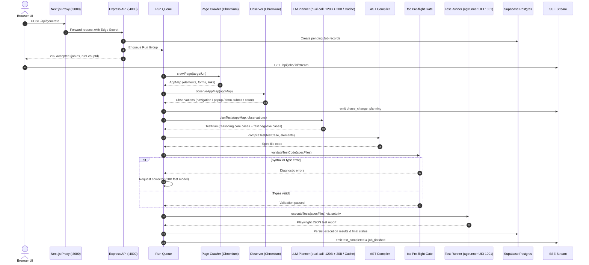
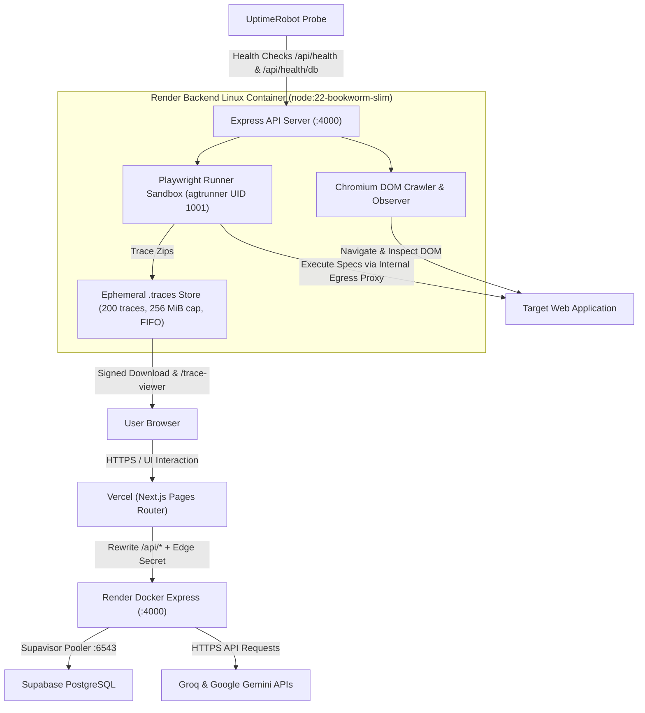
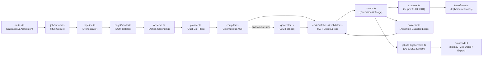
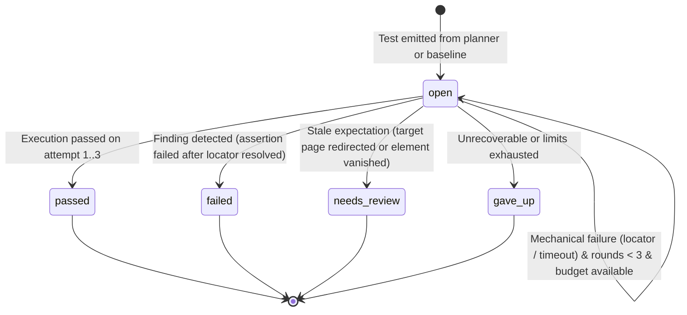
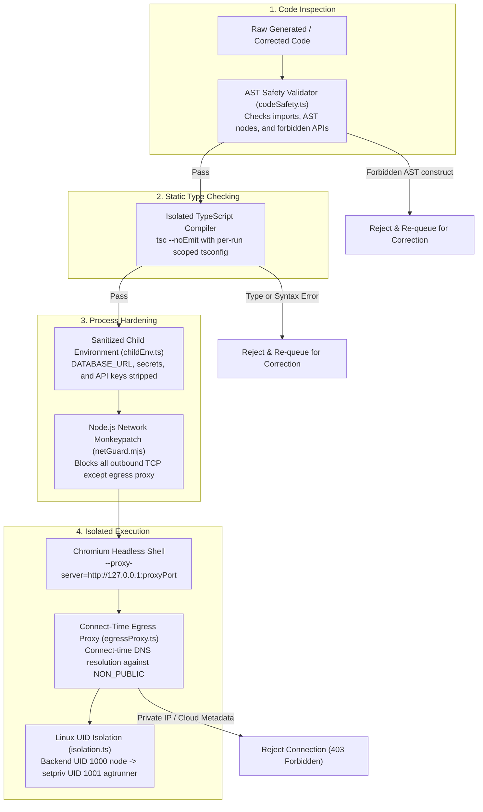
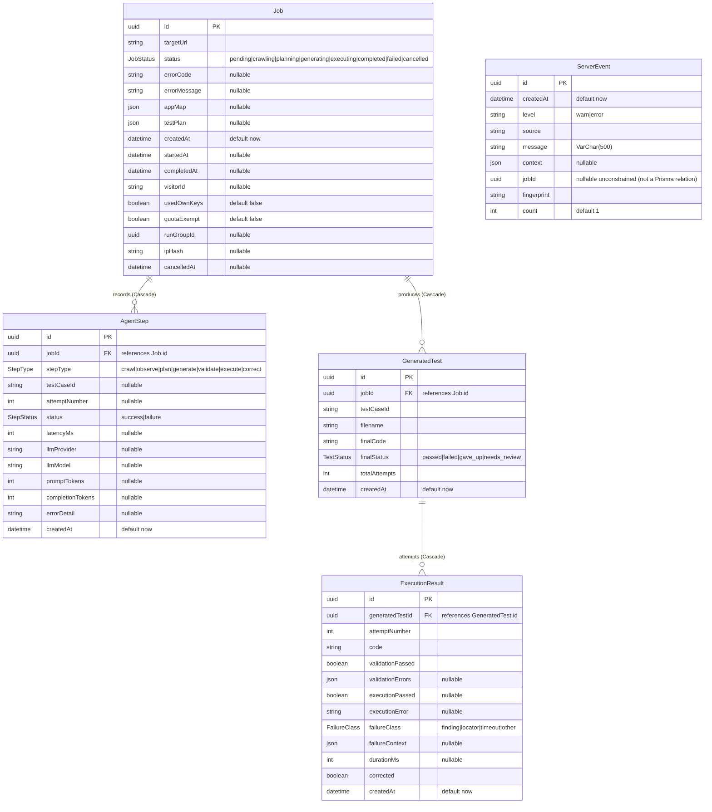

<div align="center">

# Agentic Test Case Generator

Generates typed Playwright end-to-end test suites from live web applications using deterministic DOM inspection and bounded correction loops.

<p>
  <a href="https://www.typescriptlang.org/"></a>
  <a href="https://nodejs.org/"></a>
  <a href="https://nextjs.org/"></a>
  <a href="https://expressjs.com/"></a>
  <a href="https://playwright.dev/"></a>
  <a href="https://www.prisma.io/"></a>
  <a href="https://supabase.com/"></a>
  <a href="https://tailwindcss.com/"></a>
  
</p>

<p>
  <a href="#how-it-works">How it works</a> &middot;
  <a href="#deployment-architecture">Deployment architecture</a> &middot;
  <a href="#code-workflow">Code workflow</a> &middot;
  <a href="#database-schema">Database schema</a> &middot;
  <a href="#storage--state-matrix">Storage &amp; state</a> &middot;
  <a href="#test-lifecycle">Test lifecycle</a> &middot;
  <a href="#architecture-decisions">Architecture decisions</a> &middot;
  <a href="#security-model">Security</a> &middot;
  <a href="#limits--modes">Limits &amp; modes</a> &middot;
  <a href="#measured-results">Measured results</a> &middot;
  <a href="#run-locally">Run locally</a> &middot;
  <a href="#api-reference">API</a>
</p>

</div>

---

## What It Does

- **Discovers interactive state directly from the DOM:** Navigates the target URL using headless Chromium, cataloging visible buttons, inputs, links, forms, and semantic accessibility roles into a structured AppMap.
- **Plans targeted test scenarios:** Submits the discovered element tree to an LLM reasoning model to design user journeys across validation, navigation, state changes, and negative edge cases.
- **Includes built-in baseline checks:** Automatically injects deterministic checks alongside AI scenarios: `smoke-1` (no uncaught JavaScript errors on load) and `smoke-2` (linked pages respond).
- **Compiles Playwright TypeScript deterministically:** Synthesizes typed test files using strict locator priority rules without model hallucination on the compiled path (falling back to generative LLM synthesis only when compilation throws `CompileError`).
- **Enforces a static compilation gate:** Pre-validates every emitted test via `tsc --noEmit` in a child process before executing any browser code.
- **Runs tests in isolated Chromium processes:** Executes generated tests in Chromium (Chromium-only execution) inside a sandboxed runner sandbox.
- **Classifies and isolates failures:** Distinguishes assertion discrepancies from mechanical harness failures (missing locators, network timeouts); mechanical failures undergo bounded correction while assertion failures are preserved.
- **Exports complete test suites:** Packages validated tests into a runnable Playwright project zip complete with `playwright.config.ts`, `.env.example`, and a GitHub Actions workflow.
- **Serves owner-only Playwright trace replay for every execution attempt:** Every test execution attempt (initial runs and corrector passes) captures a Playwright trace zip retained in ephemeral storage with a 200-trace cap, 256 MiB total retained byte ceiling, 25 MiB single trace limit, FIFO eviction by createdAt, and 1-hour TTL (`backend/src/runner/traceStore.ts`). The job page **Replay** tab provides an embedded trace viewer and direct zip download, gated to the job owner via signed tokens with a 10-minute TTL.
- **Accepts per-site test data without persisting secrets server-side:** Form credentials are supplied per normalized target URL (`TestDataEntrySchema`, `backend/src/api/schemas.ts`) and replaced with `__AGT_SECRET_n__` placeholders before planning or storage; real values are substituted only at execution time on the ephemeral file. Secrets are never stored in the database and never sent to the model. Credentials the user asks to remember are kept only in their own browser `localStorage` (30 days) for prefill.

---

## How It Works



### Execution Walkthrough

1. **Submission & Admission (`backend/src/api/routes.ts`):** Client submits target URLs with an ALTCHA proof-of-work payload. The API enforces public network policy (`assertPublicTarget`), checks daily quotas, verifies the signed visitor ID sent in the `X-Visitor-Id` header, and pushes the run into the in-process queue.
2. **DOM Crawl (`backend/src/crawler/pageCrawler.ts`):** Headless Chromium navigates to the target, collects interactive elements, computes accessible roles and CSS selectors, and serializes the DOM into an AppMap.
3. **Grounded Observation (`backend/src/crawler/observe.ts`, invoked during `runPipeline` in `backend/src/agent/pipeline.ts`):** Headless Chromium drives the crawled page to record **grounded facts** before planning: `navigation` (where a link leads), `popup` (popups opened by links), `form_empty_submit` (submit with empty fields), `form_filled_submit` (submit with provided test data), and `count` (repeated-item counts). Observation is bounded (`MAX_OBSERVATIONS=25`, 5 s per action, 45 s overall deadline, up to 6 links and 3 forms) and best-effort — it records what it can and **never fails the job**; if the AppMap already carries observations, the step is skipped.
4. **Plan Synthesis (`backend/src/agent/steps/planner.ts`):** The AppMap and its observations are checked against the in-memory plan cache. On a cache miss, the planner runs in **dual-call** mode: a high-reasoning model plans core cases and a fast model plans negative cases, bounded by `MAX_AI_TEST_CASES` and `MAX_TEST_CASES` (`backend/src/agent/run.config.ts`). When focus elements are supplied (via the optional `focus` field on `POST /api/generate`), the planner runs a single constrained call instead.
5. **Deterministic Compilation (`backend/src/agent/steps/compiler.ts`):** Scenarios are mapped directly into `@playwright/test` TypeScript files by looking up referenced elements from the AppMap.
6. **Static Type-Check Gate (`backend/src/runner/validator.ts`):** Emitted test code is written to an ephemeral directory with a scoped `tsconfig.json` and compiled with `tsc --noEmit`.
7. **Sandboxed Execution (`backend/src/runner/executor.ts`):** Playwright runs the test files in headless Chromium. In production Linux containers, execution runs under an unprivileged user (`agtrunner`, UID 1001) with network access restricted to the internal egress proxy.
8. **Triage & Correction Loop (`backend/src/agent/rounds.ts`):** Results are parsed. Passing tests are marked `passed`. Real assertion discrepancies become `failed`. Mechanical locator and timeout issues trigger correction attempts (up to 3 rounds) using a fast model.
9. **Persistence & Streaming (`backend/src/agent/jobEvents.ts`):** State transitions and test outcomes are saved in Supabase and pushed in real time to the browser UI over Server-Sent Events.

---

## Deployment Architecture



> [!IMPORTANT]
> **Containerized Playwright Runner:**
> Playwright browser execution runs exclusively inside the Render Docker container on Linux under an unprivileged user (`agtrunner`, UID 1001) with internal egress proxy network barriers. Playwright never runs on Vercel and never executes inside the user's browser.

---

## Code Workflow

The end-to-end execution path maps directly through the following architectural layers:



| Phase | Core Source File | Primary Responsibility |
|---|---|---|
| **1. Routes & Admission** | [`backend/src/api/routes.ts`](backend/src/api/routes.ts) | Request validation with Zod schemas, ALTCHA proof-of-work verification, IP & visitor rate-limiting, edge secret verification. |
| **2. Queue Management** | [`backend/src/agent/jobRunner.ts`](backend/src/agent/jobRunner.ts) | In-memory `runQueue` concurrency control, run-group lifecycle, non-blocking job detachment. |
| **3. Pipeline Orchestration** | [`backend/src/agent/pipeline.ts`](backend/src/agent/pipeline.ts) | Step sequencing, status transitions, phase announcements, trace owner resolution, confidence scoring. |
| **4. DOM Crawl** | [`backend/src/crawler/pageCrawler.ts`](backend/src/crawler/pageCrawler.ts) | Headless Chromium navigation, interactive element indexing, role computation, AppMap generation. |
| **5. Action Grounding** | [`backend/src/crawler/observe.ts`](backend/src/crawler/observe.ts) | Empirical observation of navigation targets, popups, form submissions, and repeated elements without failing the job. |
| **6. Scenario Planning** | [`backend/src/agent/steps/planner.ts`](backend/src/agent/steps/planner.ts) | In-memory plan cache lookup, dual-call LLM prompt execution (reasoning core + fast negative), schema validation, self-repair. |
| **7. Code Synthesis** | [`backend/src/agent/steps/compiler.ts`](backend/src/agent/steps/compiler.ts) | Deterministic AST compilation using strict locator preference; falls back to [`generator.ts`](backend/src/agent/steps/generator.ts) on `CompileError`. |
| **8. Pre-Flight Safety Gate** | [`backend/src/runner/codeSafety.ts`](backend/src/runner/codeSafety.ts) & [`validator.ts`](backend/src/runner/validator.ts) | AST safety check (rejects process, child_process, dangerous filesystem APIs) followed by static type preflight (`tsc --noEmit`). |
| **9. Guarded Execution Rounds** | [`backend/src/agent/rounds.ts`](backend/src/agent/rounds.ts) | Multi-attempt test execution orchestration; error classification (`finding`, `locator`, `timeout`); bounded correction via [`corrector.ts`](backend/src/agent/steps/corrector.ts) with strict assertion preservation. |
| **10. Sandboxed Execution** | [`backend/src/runner/executor.ts`](backend/src/runner/executor.ts) | Isolated execution via Linux `setpriv` (unprivileged `agtrunner` UID 1001), netGuard egress enforcement, Playwright JSON report extraction. |
| **11. Trace Persistence** | [`backend/src/runner/traceStore.ts`](backend/src/runner/traceStore.ts) | Ephemeral zip trace store with 200-trace cap, 256 MiB byte ceiling, FIFO eviction by `createdAt`, and HMAC-signed 10-minute access tokens. |
| **12. Persistence & Streaming** | [`backend/src/db/jobs.ts`](backend/src/db/jobs.ts) & [`jobEvents.ts`](backend/src/agent/jobEvents.ts) | Transactional database recording to Supabase PostgreSQL and real-time SSE stream events dispatched to the frontend. |
| **13. UI Delivery & Export** | [`frontend/src/components/ReplayPanel.tsx`](frontend/src/components/ReplayPanel.tsx) & [`projectExporter.ts`](backend/src/agent/projectExporter.ts) | Embedded Playwright Trace Viewer rendering in browser, direct trace zip download, and standalone runnable Playwright project zip download. |

---

## Test Lifecycle



### Transition Rules

- **`open -> passed`:** The Playwright test executed to completion with all assertions satisfied.
- **`open -> failed`:** Execution failed with a classified `finding` (an assertion expectation failed on an element that resolved in the DOM). The assertion preservation guard prohibits modifying assertions; findings are never auto-corrected.
- **`open -> needs_review`:** The page redirected to an unexpected URL before the assertion executed, leaving selectors looking for elements from the prior page (`backend/src/agent/staleExpectation.ts`).
- **`open -> gave_up`:** Reached when any of the following occur:
  - Mechanical failure persisted across 3 full execution rounds.
  - Job token budget was exceeded (`JOB_TOKEN_BUDGET`).
  - AST code safety checks rejected the code and correction could not produce safe code.
  - Test is a baseline check (built-in checks are never altered by the model).
- **`open -> open`:** A mechanical failure occurred (`locator`, `timeout`, or generic runner error), the current round is less than 3, and tokens remain. Corrected code is generated and submitted to the static type check for the next round.

---

## Architecture Decisions

| Decision | Why | Trade-off Accepted |
|---|---|---|
| [Observe-first grounding](#decision-1-observe-first-grounding) | Eliminates hallucinated selectors by cataloging DOM elements before planning, and grounds success assertions in observed page behavior. | Cannot test paths guarded behind interactions not discovered during crawl; success outcomes that were never observed cannot be asserted. |
| [Two-tier model separation](#decision-2-two-tier-model-separation) | Uses a high-capacity model for core scenario planning, a fast model for negative scenarios and locator repairs. | Requires coordinating two distinct model profiles and fallback pathways; dual-call planning costs more tokens than a single planning call. |
| [Plan caching](#decision-3-plan-caching) | Cuts median token consumption by ~85% on cache hits when re-testing stable URLs. | Cache hits reuse prior test structures until cache expiration or target changes. |
| [Static type-check gate](#decision-4-static-type-check-gate) | Blocks syntax and type errors from consuming browser execution time. | Adds 1–2 seconds of `tsc` overhead per validation round. |
| [Guarded round execution](#decision-5-guarded-round-execution) | Prevents the model from weakening assertions to artificially pass broken tests. | Tests that fail valid assertions cannot be auto-repaired and remain marked as failures. |
| [Built-in baseline checks](#decision-6-built-in-baseline-checks) | Injects smoke-1 (no uncaught JS errors) and smoke-2 (linked pages respond) without LLM calls. | A failing check classified as a finding stays failed; mechanical failures become gave_up; checks are never sent to corrector. |
| [Secret token substitution](#decision-7-secret-token-substitution) | Shields passwords and credentials from LLMs, databases, and logs. | Complex multi-stage credentials require manual mapping via the preview interface. |
| [In-process run queue](#decision-8-in-process-run-queue) | Eliminates Redis operational complexity for single-instance container hosting. | In-flight queue state does not persist across container restarts or horizontal scaling. |
| [Server-Sent Events](#decision-9-server-sent-events) | Delivers lightweight, unidirectional live job progress over standard HTTP. | Client cannot push data backward over the same stream (uses discrete REST endpoints). |
| [Postgres connection pooling](#decision-10-postgres-connection-pooling) | Operates reliably within Supabase free-tier connection limits using PgBouncer. | Direct connection required separately for migrations due to lack of advisory locks. |
| [Daily admission quotas](#decision-11-daily-admission-quotas) | Prevents upstream denial-of-service and API depletion on public deployments. | Legitimate heavy users must bring their own API keys once daily limits are reached. |
| [Target classification and wake handling](#decision-12-target-classification-and-wake-handling) | Handles sleeping free-tier host cold starts without failing the run immediately. | Initial runs on sleeping targets must wait for external spin-up delays. |
| [Free-tier deployment profile](#decision-13-free-tier-deployment-profile) | Enables hosting across Render, Vercel, and Supabase free allocations. | Constrained to 512 MB RAM, concurrency of 1, and scaled execution timeouts. |
| [Multi-channel test export](#decision-14-multi-channel-test-export) | Provides immediately executable Playwright suites runnable in developer CI/CD. | Generated suites require installing Playwright dependencies in the target environment. |

<details>
<summary><strong>Expand All Architecture Decision Records</strong></summary>

### Decision 1: Observe-First Grounding

- **Context:** LLMs tasked with authoring browser tests from URLs or screenshots routinely hallucinate CSS classes, non-existent button texts, or deprecated IDs.
- **Decision:** Crawl the real DOM first with headless Chromium before engaging the planner model, then **observe** the crawled page to record grounded facts (navigation targets, popups, empty/filled form submits, repeated-item counts) as implemented in [backend/src/crawler/observe.ts](backend/src/crawler/observe.ts) and invoked during `runPipeline` in [backend/src/agent/pipeline.ts](backend/src/agent/pipeline.ts). Compile locators deterministically using strict preference ordering: `getByTestId` &rarr; `getByRole` &rarr; `getByPlaceholder` &rarr; `getByLabel` &rarr; `getByText` &rarr; CSS selector.
- **Why:** Deterministic mapping produces Playwright code that adheres to official testing best practices and aligns with actual page elements without model hallucination on the compiled path. Grounding rules force **success** assertions to be derived from observed facts, so a test cannot assert a success outcome (a post-submit URL, a hidden element, a reset field) that the observation run never produced. When `compileTest` throws `CompileError` (such as unresolvable element references), the pipeline falls back to the LLM generator (`generateTest`, origin `'llm'`) as implemented in [backend/src/agent/pipeline.ts](backend/src/agent/pipeline.ts).
- **Trade-off Accepted:** Dynamic elements that appear only after complex multi-step user interactions are not visible during the initial crawl, and paths the observation run did not exercise cannot be asserted as successes. Observing adds a dedicated browser pass (measured median ~11 s per run).
- **Where in Code:** `backend/src/crawler/pageCrawler.ts`, `backend/src/crawler/observe.ts`, `backend/src/agent/steps/compiler.ts` (`compileTest`), `backend/src/agent/pipeline.ts` (`runPipeline`).

### Decision 2: Two-Tier Model Separation

- **Context:** Running a high-parameter reasoning model for small locator syntax adjustments is inefficient and exhausts request limits, while a single planning call tends to blur core journeys and negative edge cases.
- **Decision:** Split LLM responsibilities into two tiers and use both during planning (**dual-call**): the high-reasoning tier (configured via environment variables `GROQ_REASONING_MODEL` / `GEMINI_REASONING_MODEL`) plans the **core** cases, and the fast low-latency tier (`GROQ_FAST_MODEL` / `GEMINI_FAST_MODEL`) plans the **negative** cases, with the two sides merged and capped at `MAX_AI_TEST_CASES` planned cases inside the `MAX_TEST_CASES` total ([backend/src/agent/run.config.ts](backend/src/agent/run.config.ts)). The fast tier also handles targeted locator repairs during correction. Route all calls through an ordered provider list (`LLM_PROVIDER_ORDER`, defaulting to `groq,gemini`) using standard `fetch` without vendor SDKs. When focus elements are supplied (via the `focus` field on `POST /api/generate`), or the dual-call token budget would be exceeded, the planner falls back to a single constrained call.
- **Why:** Separating core from negative planning raises journey coverage while keeping each prompt narrow; the fast tier minimizes latency and token consumption during error recovery.
- **Trade-off Accepted:** Prompts must be maintained and validated across multiple provider implementations, and dual-call planning consumes more tokens than a single planning call (measured: median fresh tokens 3,113 → 10,213 after Phase 12).
- **Where in Code:** `backend/src/agent/steps/planner.ts` (`planTests`), `backend/src/agent/run.config.ts`, `backend/src/config.ts`, `backend/src/llm/client.ts` (`callLlm`), `backend/src/llm/providers/openAiCompatible.ts`.

### Decision 3: Plan Caching

- **Context:** Re-testing the same application URL during continuous development generates identical crawl structures and prompts.
- **Decision:** Hash the plan-relevant inputs — the AppMap view, supplied test data, planning focus, and the observed facts (`buildPlanCacheKey`, [backend/src/agent/planCache.ts:14-28](backend/src/agent/planCache.ts#L14-L28)). On match, serve the previously synthesized scenario plan from memory while re-executing fresh compilation and browser runs. Entries expire after 6 hours (max 100 entries).
- **Why:** Measured results demonstrated an 85.5% median token reduction on cache hits (1,480 vs 10,213 tokens) while bypassing planner latency entirely.
- **Trade-off Accepted:** UI changes on the target URL that do not alter the top-level element structure reuse the cached scenario set until cache eviction or force-fresh execution.
- **Where in Code:** `backend/src/agent/planCache.ts`, `backend/src/agent/pipeline.ts`.

### Decision 4: Static Type-Check Gate

- **Context:** Generated TypeScript code may contain invalid variable references, broken Playwright imports, or bad syntax.
- **Decision:** Write generated tests to an isolated directory with an extended `tsconfig.json` and invoke `tsc --noEmit` before launching any browser process.
- **Why:** Failing fast on compiler errors avoids launching Chromium instances for broken code, saving CPU cycles and process overhead.
- **Trade-off Accepted:** Adds 1–2 seconds of TypeScript compilation time prior to browser launch.
- **Where in Code:** `backend/src/runner/validator.ts`.

### Decision 5: Guarded Round Execution

- **Context:** LLM correction loops frequently alter or delete failing assertions to force tests to pass, hiding real application bugs.
- **Decision:** AST checks verify that every assertion in the original code is structurally preserved in the corrected code (`assertionGuard.ts`). Any test where a locator resolved but the assertion failed is classified as a `finding` and immediately locked as `failed`.
- **Why:** Guarantees that automated correction only fixes mechanical harness issues (such as strict mode selector collisions) and never masks a regression.
- **Trade-off Accepted:** Tests that fail due to legitimate application defects cannot be automatically repaired to test subsequent steps.
- **Where in Code:** `backend/src/agent/rounds.ts`, `backend/src/agent/assertionGuard.ts`.

### Decision 6: Built-in Baseline Checks

- **Context:** Web applications share foundational quality requirements (clean runtime page execution and working links) that do not require generative planning.
- **Decision:** Inject deterministic baseline tests alongside AI-generated scenarios: `smoke-1` (no uncaught JavaScript errors on load) and `smoke-2` (linked pages respond). Label them distinctly in the UI as **Built-in check** versus **Generated scenario**.
- **Why:** Guarantees baseline regression coverage on every run even if LLM rate limits or token budgets are reached.
- **Trade-off Accepted:** A failing built-in check classified as a finding stays failed; mechanical failures become `gave_up`; built-in checks are never sent to the corrector.
- **Where in Code:** `backend/src/agent/baseline.ts:31-77`, `backend/src/agent/rounds.ts:330-348`, `frontend/components/job/TestResultCard.tsx:122,136`.

### Decision 7: Secret Token Substitution

- **Context:** End-to-end tests often require sensitive authentication credentials (passwords, tokens). Sending these to public LLMs or storing them in databases is a security hazard.
- **Decision:** Replace sensitive inputs with placeholder tokens (`__AGT_SECRET_1__`) in the prompt and database records. Inject real values only into the ephemeral test file on disk immediately before Playwright execution. Store browser credentials strictly in the user's browser `localStorage` (30-day TTL).
- **Why:** Zero credential exposure across LLM provider logs, server database records, and event streams.
- **Trade-off Accepted:** The user must enter credentials on the client preview interface prior to test generation.
- **Where in Code:** `backend/src/agent/testData.ts`, `backend/src/runner/executor.ts:212-217`, `frontend/lib/rememberedTestData.ts`.

### Decision 8: In-Process Run Queue

- **Context:** Distributed queues (e.g. BullMQ with Redis) introduce infrastructure overhead and operational complexity on free-tier hosting.
- **Decision:** Implement an in-memory run queue with a per-client claim token ensuring at most one active execution per visitor.
- **Why:** Zero operational dependencies beyond PostgreSQL; fits cleanly within free container environments.
- **Trade-off Accepted:** Queue state is in-memory; restarting the backend process drops queued jobs (though running jobs are marked failed on reboot via orphan reconciliation).
- **Where in Code:** `backend/src/agent/runQueue.ts`, `backend/src/maintenance/reconcileJobs.ts`.

### Decision 9: Server-Sent Events

- **Context:** Browser clients require real-time execution feedback (phase changes, live test completion, logs).
- **Decision:** Stream execution events over HTTP Server-Sent Events (`/api/jobs/:id/stream`) with a 15-second heartbeat ping and reconnect replay buffer. Proxy requests through Next.js rewrites with `no-transform` cache headers.
- **Why:** Works over standard HTTP/1.1 and HTTP/2 without WebSocket connection upgrades, corporate firewall blocks, or stateful socket servers.
- **Trade-off Accepted:** SSE is strictly unidirectional; client cancellations and actions must use standard HTTP POST requests.
- **Where in Code:** `backend/src/api/jobStream.ts`, `backend/src/agent/jobEvents.ts`, `frontend/next.config.js:8`.

### Decision 10: Postgres Connection Pooling

- **Context:** Free-tier PostgreSQL instances (such as Supabase) enforce strict connection ceilings (typically 15–20 direct connections).
- **Decision:** Route runtime application queries through Supabase's transaction pooler (PgBouncer on port 6543) with `connection_limit=1`. Restrict direct connections (port 5432) strictly to administrative migration commands (`prisma migrate deploy`).
- **Why:** Prevents connection starvation during bursts of crawler or runner queries.
- **Trade-off Accepted:** Advisory locks and prepared statements cannot be used in runtime application queries.
- **Where in Code:** `backend/prisma/schema.prisma:7-8`, `docs/DEPLOY.md:9-23`.

### Decision 11: Daily Admission Quotas

- **Context:** A public test generation service is vulnerable to automated scraping and denial-of-service that could rapidly exhaust upstream provider quotas.
- **Decision:** Enforce admission control using ALTCHA proof-of-work challenges, HMAC-signed visitor tokens, and strict daily execution budgets per visitor (8 runs) and per IP (20 runs). Disallow anonymous access once limits are reached unless the user provides their own API key (BYOK).
- **Why:** Protects hosting infrastructure and API quotas without requiring user registration or credit cards.
- **Trade-off Accepted:** Legitimate shared-IP users (such as corporate offices) may encounter IP caps sooner.
- **Where in Code:** `backend/src/security/dailyBudget.ts`, `backend/src/security/pow.ts`, `backend/src/api/visitorMiddleware.ts`.

### Decision 12: Target Classification and Wake Handling

- **Context:** Free cloud hosting providers (Render, Koyeb, Railway, Fly.io) put inactive applications to sleep, causing initial HTTP requests to take 30–60 seconds or return 502/503 status codes.
- **Decision:** Inspect navigation failures against known waking host suffixes and cold-start page signatures. When detected, classify the failure as `TARGET_WAKING`, emit a warning event, and instruct the client to wait with a 30-second `Retry-After` header.
- **Why:** Prevents marking sleeping web applications as broken, giving them time to spin up.
- **Trade-off Accepted:** Crawl requests for cold-started targets experience an intentional delay before testing begins.
- **Where in Code:** `backend/src/crawler/wakeDetect.ts`, `backend/src/crawler/gotoErrors.ts`, `backend/src/api/errors.ts:76`.

### Decision 13: Free-Tier Deployment Profile

- **Context:** The application is architected to operate indefinitely across free hosting tiers without incurring server infrastructure fees.
- **Decision:** Deploy backend to Render's free Docker tier (512 MB RAM, 0.1 CPU, `RUNNER_TIMEOUT_SCALE=3`), frontend to Vercel, and database to Supabase. Configure external UptimeRobot monitors to ping `/api/health` every 5 minutes (preventing container sleep) and `/api/health/db` every 12 hours (preventing database pausing).
- **Why:** Provides continuous availability and full end-to-end functionality without infrastructure spend.
- **Trade-off Accepted:** Render's free tier provides 750 free hours per month; keeping one service continuously awake consumes 744 hours (leaving 6 hours margin). Concurrency must be pinned to 1.
- **Where in Code:** `render.yaml`, `backend/Dockerfile`, `docs/DEPLOY.md`, `docs/OPERATIONS.md`.

### Decision 14: Multi-Channel Test Export

- **Context:** Tests generated in a hosted browser tool are only valuable if engineering teams can easily integrate them into their development repositories.
- **Decision:** Provide an export endpoint that streams a zip archive containing individual `@playwright/test` specs, a `playwright.config.ts`, a `.env.example` mapping parameter secrets, and a ready-to-run GitHub Actions workflow (`.github/workflows/playwright.yml`).
- **Why:** Enables teams to run the generated test suite locally or inside CI/CD with a single command.
- **Trade-off Accepted:** Tests marked `needs_review` are excluded from the zip and listed in its README (`backend/src/export/projectExporter.ts:61-62,190-194`).
- **Where in Code:** `backend/src/export/projectExporter.ts`, `backend/src/api/jobsRoutes.ts:256`.

</details>

---

## Security Model



### Defense-in-Depth Boundary

The AST static analysis check (`codeSafety.ts`) inspects the TypeScript syntax tree to reject known dangerous constructs: dynamic code evaluation (`eval`, `Function`), sensitive process globals (`process`, `globalThis`), network primitives (`fetch`, `WebSocket`), and access to object prototypes (`constructor`, `__proto__`). 

> [!NOTE]
> Static AST inspection is defense-in-depth, not an impregnable security boundary. Target web pages can attempt prompt-injection attacks to trick LLMs into generating obfuscated payloads. The true operational boundary is enforced at the OS and network level:
> 1. The test runner executes as a dedicated unprivileged user (`agtrunner`, UID 1001) with zero Linux capabilities and `no_new_privs` enabled. Linux kernel permissions prevent UID 1001 from accessing backend process memory (`/proc/<pid>/mem`) or environment variables (`/proc/<pid>/environ`).
> 2. All outbound network traffic is forced through an internal egress proxy that re-resolves hostnames at connection time and blocks private subnets, loopback addresses, and cloud instance metadata endpoints (`169.254.169.254`).

---

## Limits & Modes

### System Limits & Budgets

| Parameter | Default Value | Purpose | Source File |
|---|---|---|---|
| `GENERATE_DAILY_LIMIT` | `40` | Maximum total job generations allowed per day globally | `backend/src/config.ts:39` |
| `FREE_VISITOR_DAILY_LIMIT` | `8` | Maximum job generations allowed per visitor ID per day | `backend/src/config.ts:40` |
| `FREE_IP_DAILY_LIMIT` | `20` | Maximum job generations allowed per client IP per day | `backend/src/config.ts:41` |
| `FREE_MAX_URLS_PER_RUN` | `3` | Maximum URLs in a single run group for free users | `backend/src/config.ts:42` |
| `BYOK_MAX_URLS_PER_RUN` | `5` | Maximum URLs in a single run group for BYOK or local users | `backend/src/config.ts:43` |
| `CRAWL_DAILY_LIMIT_PER_IP` | `40` | Maximum crawl previews allowed per IP per day | `backend/src/config.ts:44` |
| `POW_DAILY_LIMIT_PER_IP` | `200` | Maximum proof-of-work challenges issued per IP per day | `backend/src/config.ts:45` |
| `BYOK_VALIDATE_DAILY_LIMIT_PER_IP` | `50` | Maximum BYOK key validation requests per IP per day | `backend/src/config.ts:46` |
| `PIPELINE_CONCURRENCY` | `1` | Simultaneous test generation pipelines executed | `backend/src/config.ts:47` |
| `QUEUE_MAX_WAITING_GROUPS` | `5` | Maximum queued runs waiting in the in-process queue | `backend/src/config.ts:48` |
| `MAX_AI_TEST_CASES` | `8` | Maximum AI-planned cases per run (inside the total cap) | `backend/src/agent/run.config.ts` |
| `MAX_TEST_CASES` | `12` | Maximum total test cases per run (AI + baseline) | `backend/src/agent/run.config.ts` |
| `JOB_TOKEN_BUDGET` | `40000` | Total token budget ceiling per test generation job | `backend/src/config.ts:56` |
| `MAX_ELEMENTS_PER_PAGE` | `200` | Maximum interactive DOM elements indexed per page | `backend/src/config.ts:21` |
| `NAVIGATION_TIMEOUT_MS` | `30000` | Browser navigation timeout during crawler indexing | `backend/src/config.ts:22` |
| `RUNNER_TIMEOUT_SCALE` | `1` (Render: `3`) | Multiplier for test execution timeouts on constrained CPUs | `backend/src/config.ts:57` |

### Execution Modes

| Mode | Target Reachability | Admission Requirements | Intended Environment |
|---|---|---|---|
| **Hosted Mode** | Public internet targets only. Private IPs and localhost blocked by `netPolicy.ts`. | ALTCHA proof-of-work required. Daily IP and visitor limits enforced. | Public production deployments (Vercel + Render). |
| **Tunnel Mode** | Localhost and private targets exposed via secure tunnel (e.g. `ngrok` or `cloudflared`). | Standard hosted mode rules apply; tunnel hostname treated as public target. | Testing local developer servers from hosted deployment. |
| **Local Agent Mode** | Direct access to `localhost`, `127.0.0.1`, and private intranet subnets. | All admission limits, quotas, and proof-of-work checks disabled. | Local workstation development (`LOCAL_AGENT_MODE=true`). |

---

## Measured Results

Measurements recorded from a live 12-run verification matrix re-run after Phase 12 (Observe step + dual-call planning + success-only grounding) — full report: [`docs/measurements/2026-10-phase12-measurement.md`](docs/measurements/2026-10-phase12-measurement.md):

- **Commit:** `2563338`
- **Date:** October 21, 2026
- **Configuration:** `LOCAL_AGENT_MODE=false` (egress proxy enabled), `BASELINE_TESTS=true`, `JOB_TOKEN_BUDGET=40000` (one run capped at `8000`), harness run under `MEASURE=1`. `A11Y_SMOKE`/`smoke-3` no longer exist in the product and were not used.

| Metric | Measured Value | Notes |
|---|---|---|
| Total Runs Executed | 12 | Same matrix as the baseline (TodoMVC, the-internet, saucedemo, practicetestautomation); 1 run failed at planning with 0 tests |
| AI Scenarios Planned | 72 | Synthesized by the dual-call planner (reasoning core + fast negative) |
| Baseline Checks Injected | 15 | Built-in smoke tests (smoke-1: no uncaught JavaScript errors on load; smoke-2: linked pages respond) |
| Total Tests Evaluated | 87 | Combined test suite execution |
| Tests Passing | 69 (79.3%) | Tests completing without failure |
| Reported Findings | 9 (10.3%) | Potential defects flagged to user |
| Tests Gave Up | 9 (10.3%) | Exhausted attempts, token limits, or unrecoverable locators |
| Repaired by Correction Loop | 3 | Strict-mode locator disambiguation (all on TodoMVC) |
| Median Fresh Run Tokens | 10,213 | Median token count without plan cache (n=11) |
| Median Cached Run Tokens | 1,480 | 85.5% reduction in token consumption on cache hit |
| Median Wall Time | 70.1s | Across crawl, observe, plan, compile, execution, and triage |
| Median Observe Step Latency | 11.2s | New Phase 12 phase (per-run range 5.7–22.7s) |

**Previous measurement (`c89620e`, pre-Phase-12):** pass rate 66.7% (56/84), false-finding rate 100% (20/20), median fresh tokens 3,113, median wall time 62.8s — full detail in [`docs/measurements/2026-10-measurement.md`](docs/measurements/2026-10-measurement.md).

> [!WARNING]
> **Known Pipeline Limitations Identified During Measurement**
> 1. **False-finding rate unchanged at 100% of reported findings:** In the 12-run measurement, all 9 reported findings (plus 1 `gave_up`) were test bugs rather than genuine target defects — no genuine defect was detected in any run. The *volume* of findings more than halved (20 → 9) and pass rate rose (66.7% → 79.3%), but the *rate* did not move. Observe-first grounding only guards **success** assertions; the remaining false findings come from the fast/negative tier — 5 negatives inject valid test-data credentials and then assert the login must fail, and 4 assert unobserved post-submit state changes (a field resets, an element becomes hidden).
> 2. **Low Correction Success Rate (30.0% attempt success):** The correction loop succeeded in 3 of 10 attempts (3 of 8 multi-attempt tests), all strict-mode locator disambiguation on TodoMVC. Every attempt on role-based login locators (the-internet/saucedemo/practicetestautomation) exhausted its retries.
> 3. **Planning cost and reliability:** Dual-call planning roughly tripled median fresh tokens (3,113 → 10,213) and nearly doubled LLM calls per run (1.8 → 3.4), and added a dedicated ~11 s observe phase. One run (Run 4) produced zero tests because both dual-call sides and the self-repair call failed output-schema validation.
> 4. Negating the fast/negative tier (never inject valid credentials into a "must fail" case; never assert an unobserved state change) and supplying navigation-aware correction guidance are the central objectives of the next tuning phase.

---

## Run Locally

### Prerequisites

- **Node.js:** Node 22 (Docker image `node:22-bookworm-slim`); tested on `v24.14.1`
- **Package Manager:** `pnpm` (version 12.8.1)
- **Database:** PostgreSQL database instance (local PostgreSQL or Supabase project)
- **LLM API Key:** At least one API key from Groq or Google Gemini

### Setup Instructions (PowerShell)

```powershell
# 1. Clone repository and navigate to root
git clone https://github.com/vansh412f/agentic-test-case-generator.git
cd agentic-test-case-generator

# 2. Configure Backend
cd backend
Copy-Item .env.example .env

# Edit .env with your credentials:
# DATABASE_URL, DIRECT_URL, and at least one LLM key (GROQ_API_KEY)
# For local use without quotas, set LOCAL_AGENT_MODE=true

pnpm install
pnpm exec prisma migrate deploy
pnpm exec playwright install chromium
cd ..

# 3. Configure Frontend
cd frontend
Copy-Item .env.example .env.local
pnpm install
cd ..

# 4. Start Services in Separate Terminals
# Terminal 1 (Backend on http://localhost:4000):
cd backend
pnpm dev

# Terminal 2 (Frontend on http://localhost:3000):
cd frontend
pnpm dev
```

<details>
<summary><strong>Bash Setup Instructions (Linux / macOS)</strong></summary>

```bash
# 1. Clone repository and enter directory
git clone https://github.com/vansh412f/agentic-test-case-generator.git
cd agentic-test-case-generator

# 2. Configure Backend
cd backend
cp .env.example .env

# Set DATABASE_URL, DIRECT_URL, GROQ_API_KEY, and LOCAL_AGENT_MODE=true in .env
pnpm install
pnpm exec prisma migrate deploy
pnpm exec playwright install chromium
cd ..

# 3. Configure Frontend
cd frontend
cp .env.example .env.local
pnpm install
cd ..

# 4. Start Development Servers
# Terminal 1:
cd backend && pnpm dev

# Terminal 2:
cd frontend && pnpm dev
```

</details>

---

## Configuration

<details>
<summary><strong>Backend Environment Variables (backend/src/config.ts)</strong></summary>

| Variable Name | Default Value | Required in Production? | Purpose |
|---|---|---|---|
| `PORT` | `4000` | No | Port on which the Express server listens |
| `NODE_ENV` | `development` | Yes (`production`) | Application environment (`development`, `production`, `test`) |
| `LOG_LEVEL` | `info` (prod) / `debug` (dev) | No | Winston structured logging severity level (`error`, `warn`, `info`, `debug`) |
| `HEADED_DEBUG` | `false` | No | When true in dev, launches visible browser windows for debugging |
| `CRAWL_CONCURRENCY` | `1` | No | Concurrent crawler browser contexts (1–4) |
| `MAX_ELEMENTS_PER_PAGE` | `200` | No | Maximum interactive elements indexed during crawl |
| `NAVIGATION_TIMEOUT_MS` | `30000` | No | Page navigation timeout in milliseconds |
| `NETWORK_IDLE_WAIT_MS` | `3000` | No | Network quiescence wait time after page navigation |
| `DATABASE_URL` | *(none)* | Yes | Pooled PostgreSQL connection string (PgBouncer port 6543) |
| `DIRECT_URL` | *(none)* | Yes | Direct PostgreSQL connection string for migrations (port 5432) |
| `GROQ_API_KEY` | *(none)* | Yes (or Gemini) | Groq API authentication key |
| `GEMINI_API_KEY` | *(none)* | Optional fallback | Google Gemini API authentication key |
| `GROQ_REASONING_MODELS` | `openai/gpt-oss-120b` | No | Comma-separated fallback chain for Groq reasoning (planner core, expansion, repair) |
| `GROQ_FAST_MODELS` | `openai/gpt-oss-20b,qwen/qwen3.8-27b` | No | Comma-separated fallback chain for Groq fast tier (planner negative, generator, corrector) |
| `GEMINI_REASONING_MODELS` | `gemini-3.5-flash,gemini-2.5-flash` | No | Comma-separated fallback chain for Gemini reasoning |
| `GEMINI_FAST_MODELS` | `gemini-3.1-flash-lite,gemini-3.5-flash-lite` | No | Comma-separated fallback chain for Gemini fast tier |
| `GROQ_REASONING_MODEL` | `openai/gpt-oss-120b` | No | Primary reasoning model on Groq (backward-compatible override) |
| `GROQ_FAST_MODEL` | `openai/gpt-oss-20b` | No | Primary fast model on Groq (backward-compatible override) |
| `GEMINI_REASONING_MODEL` | `gemini-3.5-flash` | No | Primary reasoning model on Gemini (backward-compatible override) |
| `GEMINI_FAST_MODEL` | `gemini-3.1-flash-lite` | No | Primary fast model on Gemini (backward-compatible override) |
| `LLM_PROVIDER_ORDER` | `groq,gemini` | No | Ordered fallback sequence for LLM provider attempts. Traversal rule: Provider order first (`LLM_PROVIDER_ORDER`). Within a provider, fallback to the next model in the chain occurs ONLY on `MODEL_UNAVAILABLE` (404/decommissioned). All other errors (auth failure, bad response, rate limit > 10s, retry exhaustion) immediately advance to the next provider. |
| `POW_SECRET` | *(none)* | Yes (&ge;16 chars) | HMAC signing secret for ALTCHA proof-of-work challenges |
| `VISITOR_SIGNING_SECRET` | *(none)* | Yes (&ge;16 chars) | HMAC signing secret for anonymous visitor session tokens |
| `ADMIN_SECRET` | *(none)* | Yes (&ge;24 chars) | Shared secret required in `X-Admin-Secret` header for admin routes |
| `EDGE_SHARED_SECRET` | *(none)* | Yes (&ge;24 chars) | Shared secret validating incoming Vercel edge rewrite proxy headers |
| `GENERATE_DAILY_LIMIT` | `40` | No | Global daily ceiling for test generation jobs |
| `FREE_VISITOR_DAILY_LIMIT` | `8` | No | Daily generation limit per anonymous visitor |
| `FREE_IP_DAILY_LIMIT` | `20` | No | Daily generation limit per client IP |
| `FREE_MAX_URLS_PER_RUN` | `3` | No | Maximum URLs per run group for free anonymous users |
| `BYOK_MAX_URLS_PER_RUN` | `5` | No | Maximum URLs per run group for BYOK or local agent runs |
| `CRAWL_DAILY_LIMIT_PER_IP` | `40` | No | Daily limit for `/api/crawl` requests per IP |
| `POW_DAILY_LIMIT_PER_IP` | `200` | No | Daily limit for proof-of-work challenge requests per IP |
| `BYOK_VALIDATE_DAILY_LIMIT_PER_IP` | `50` | No | Daily limit for API key pre-flight checks per IP |
| `PIPELINE_CONCURRENCY` | `1` | No | Maximum concurrent test execution pipelines (1–4) |
| `QUEUE_MAX_WAITING_GROUPS` | `5` | No | Maximum pending run groups allowed in memory queue |
| `BASELINE_TESTS` | `true` | No | When true, injects smoke-1 (no uncaught JavaScript errors on load) and smoke-2 (linked pages respond) |
| `WAKING_HOST_SUFFIXES` | `onrender.com,...` | No | Comma-separated host suffixes subject to cold start detection |
| `LOCAL_AGENT_MODE` | `false` | Fatal if true in prod | Disables quotas, admission checks, and private IP blocks |
| `TRUST_PROXY_HOPS` | `1` | No | Number of upstream reverse proxy hops to trust for IP extraction |
| `FRONTEND_ORIGIN` | *(none)* | Yes | Allowed frontend origin URLs for CORS (comma-separated) |
| `JOB_TOKEN_BUDGET` | `40000` | No | Maximum prompt and completion tokens consumed per job |
| `RUNNER_TIMEOUT_SCALE` | `1` | No (Render: `3`) | Multiplier scaling Playwright timeouts for low-CPU hosts |
| `RUNNER_ISOLATION` | `none` | Yes (`uid`) | Runner isolation model (`none` for dev, `uid` for prod) |
| `RUNNER_UID` | `1001` | No | Linux UID assigned to unprivileged runner process |
| `RUNNER_GID` | `1002` | No | Linux GID assigned to unprivileged runner process |
| `CORS_PREVIEW_ORIGIN_REGEX` | *(none)* | No | Regular expression pattern for dynamically allowed preview origins |
| `RETENTION_DAYS` | `30` | No | Days after which jobs are deleted by the daily retention sweep (read in `backend/src/maintenance/expireOldJobs.ts`, outside `config.ts`) |
| `SAMPLE_JOB_IDS` | *(none)* | No | Comma-separated job IDs excluded from the retention sweep and preserved past expiry (read in `backend/src/maintenance/expireOldJobs.ts`, outside `config.ts`) |

</details>

<details>
<summary><strong>Frontend Environment Variables (frontend/.env.example)</strong></summary>

| Variable Name | Default Value | Purpose |
|---|---|---|
| `BACKEND_URL` | `http://localhost:4000` | Destination address for Next.js API route rewrites |
| `EDGE_SHARED_SECRET` | *(none)* | Secret sent in `x-agt-edge-secret` header to backend |
| `NEXT_PUBLIC_SITE_URL` | `http://localhost:3000` | Canonical public URL used for metadata and OpenGraph tags |
| `NEXT_PUBLIC_DEPLOYMENT_MODE` | `local` | Fallback mode indicator (`local` or `hosted`) |
| `NEXT_PUBLIC_STREAM_ORIGIN` | *(none)* | Optional direct backend URL for SSE streams |
| `NEXT_PUBLIC_GA_ID` | *(none)* | Optional Google Analytics measurement ID |
| `NEXT_PUBLIC_GSC_VERIFICATION` | *(none)* | Optional Google Search Console HTML verification string |

</details>

---

## API Reference

<details>
<summary><strong>Complete Route Catalog & SSE Event Specification</strong></summary>

### Public Application Endpoints

| Method | Route | Description | Key Parameters | Error Codes |
|---|---|---|---|---|
| `GET` | `/api/health` | Uptime and mode health check | None | None |
| `GET` | `/api/health/db` | Supabase keep-alive ping (cached 10 min) | None | `503 SERVICE_UNAVAILABLE` |
| `GET` | `/api/stats` | Aggregated lifetime metrics | None | `INTERNAL_ERROR` |
| `GET` | `/api/pow/challenge` | Generates ALTCHA proof-of-work challenge | None | `INTERNAL_ERROR` |
| `POST` | `/api/crawl` | Previews target URL and returns AppMap | `{ url }` | `INVALID_URL`, `TARGET_UNREACHABLE`, `QUEUE_FULL` |
| `POST` | `/api/byok/validate` | Validates custom Groq or Gemini API keys | `{ provider }` + Key Header | `INVALID_REQUEST` |
| `GET` | `/api/budget` | Retrieves remaining daily runs for visitor/IP | None | None |
| `POST` | `/api/generate` | Enqueues scenario planning and test execution | `{ url, urls?, testData?, altcha? }` | `DAILY_QUOTA_EXHAUSTED`, `POW_FAILED`, `QUEUE_FULL`, `TOO_MANY_URLS` |

### Job Management Endpoints

| Method | Route | Description | Key Parameters | Error Codes |
|---|---|---|---|---|
| `GET` | `/api/jobs` | Lists historical jobs for current visitor | Query: `page`, `limit` | `INVALID_REQUEST` |
| `GET` | `/api/jobs/:id` | Returns full status and test detail for a job | Param: `id` (UUID) | `JOB_NOT_FOUND` |
| `GET` | `/api/jobs/:id/appmap` | Returns crawled AppMap for a job | Param: `id` (UUID) | `JOB_NOT_FOUND` |
| `POST` | `/api/jobs/:id/cancel` | Cancels an in-flight job or run group | Body: `{ scope: 'job' \| 'group' }` | `NOT_CANCELLABLE`, `JOB_NOT_FOUND` |
| `GET` | `/api/jobs/:id/stream` | Server-Sent Events live execution stream | Param: `id`, Header: `Last-Event-ID` | `JOB_NOT_FOUND` |
| `GET` | `/api/jobs/:id/report.html` | Generates standalone HTML run report | Param: `id` (UUID) | `REPORT_NOT_READY`, `JOB_NOT_FOUND` |
| `GET` | `/api/jobs/:id/export.zip` | Downloads runnable Playwright project zip | Param: `id` (UUID) | `NO_EXPORTABLE_TESTS`, `JOB_NOT_FOUND` |
| `GET` | `/api/jobs/:id/tests/:testCaseId/trace` | Returns signed, short-lived trace links for all execution attempts | Param: `id`, `testCaseId`, Query: `attempt?` | `JOB_NOT_FOUND` |
| `GET` | `/api/traces/:traceId` | Serves an owner-only Playwright trace zip given its signed token | Param: `traceId`, Query: `t` | `TRACE_NOT_FOUND` |

### Administrative Endpoints (Requires `X-Admin-Secret`)

| Method | Route | Description | Key Parameters | Error Codes |
|---|---|---|---|---|
| `GET` | `/api/admin/events` | Inspects recent server events and errors | Query: `level`, `since`, `limit` | `404 NOT_FOUND` (if unauthenticated) |
| `GET` | `/api/admin/whoami` | Displays resolved IP address and proxy hops | None | `404 NOT_FOUND` (if unauthenticated) |

### Server-Sent Events Specification (`/api/jobs/:id/stream`)

The SSE connection transmits continuous UTF-8 event text with an automatic 15-second heartbeat (`: ping\n\n`) and client reconnection backoff (`retry: 3000\n\n`). Events emitted:

- `snapshot`: Sent on initial connection with current job status and error codes.
- `phase_change`: Emitted when the pipeline advances (`crawling`, `planning`, `generating`, `executing`, `completed`, `failed`, `cancelled`).
- `step_recorded`: Emitted when individual pipeline steps finish (e.g. `validate`, `execute`, `crawl`).
- `test_completed`: Emitted whenever a single test case reaches terminal status (`passed`, `failed`, `gave_up`, `needs_review`).
- `queue_position`: Emitted when queued waiting for pipeline concurrency slots.
- `target_waking`: Emitted when a sleeping free host is detected, with `nextRetryInSec`.
- `budget_note`: Emitted when token budget is reached and correction stops.
- `job_finished`: Final event closing the SSE stream.
- `unavailable`: Emitted if the job process channel is no longer active in memory, prompting client fallback to REST polling.

</details>

---

## Database Schema

Database entities are managed via Prisma (`backend/prisma/schema.prisma`) and hosted on Supabase PostgreSQL:



### Relations, Cascades & Constraints
- **Cascade Deletions:** `Job` configures `onDelete: Cascade` to both `AgentStep` and `GeneratedTest`. `GeneratedTest` configures `onDelete: Cascade` to `ExecutionResult`. Expiry sweeps or manual job deletions cleanly purge all child steps and test results.
- **Unique Constraints:**
  - `GeneratedTest`: `@@unique([jobId, testCaseId])` and `@@unique([jobId, filename])` prevent duplicate case collisions.
  - `ExecutionResult`: `@@unique([generatedTestId, attemptNumber])` prevents duplicate attempt records.
- **Indexes:**
  - `Job`: `[createdAt, id]`, `[visitorId, createdAt]`, `[ipHash, createdAt]`, `[runGroupId]`.
  - `AgentStep`: `[jobId]`.
  - `GeneratedTest`: `[jobId]`.
  - `ExecutionResult`: `[generatedTestId]`.
  - `ServerEvent`: `[createdAt]`.
- **ServerEvent Decoupling:** `ServerEvent.jobId` is an unconstrained UUID column and **not a Prisma relation**. This allows system events and errors to be recorded even when a job is rejected before creation or after a job record is purged.

---

## Storage & State Matrix

| Storage Layer | Technology / Location | State Maintained | Lifecycle / Retention Policy | Security & Isolation Model |
|---|---|---|---|---|
| **Persistent Relational DB** | Supabase PostgreSQL (PgBouncer `:6543`) | Jobs, agent steps, test plans, generated test code, execution results, server events | 30-day retention sweep (`expireOldJobs.ts`); `SAMPLE_JOB_IDS` exempt | SSL required; secrets replaced with `__AGT_SECRET_n__` tokens |
| **Ephemeral Disk Storage** | Render Backend Container (`.traces/`, `tests/run-*`) | Playwright trace zips, temporary execution files and test specs | Max 200 traces, 256 MiB total cap, 25 MiB single trace limit, FIFO eviction by `createdAt`, 1-hour TTL; run dirs deleted on run completion | Traces served only via HMAC-signed 10-minute owner tokens; runner sandboxed under UID 1001 |
| **In-Memory Backend State** | Node.js Process Memory | In-flight run queue, active SSE connection listeners, plan cache (keyed by normalized URL + element hash), ALTCHA replay cache (10 min TTL), visitor token-bucket budget reservations | Process lifetime; caches have explicit TTLs (plan cache: 6 hours / 100 entries); cleared on container restart | In-memory only; non-shared across instances |
| **Browser Client Storage** | Browser `localStorage` & `sessionStorage` | Prefill test credentials (30 days in `localStorage`, user-consented), active visitor ID (`agt_visitor_id`), active run history | Client-controlled; deleted on browser clear; never transmitted except in user request payloads | Strictly client-side domain storage |
| **External Model APIs** | Groq & Google Gemini APIs | Transient LLM inference prompts and completions | No server-side retention; API keys sent via HTTPS authorization headers | Server keys or user BYOK; sensitive data redacted in logging |

---

## Observability & Structured Logging

The backend observability stack combines structured Winston logging for runtime inspection on Render with in-database event deduplication for operational alerts:

1. **Winston Structured Logger ([backend/src/observability/logger.ts](backend/src/observability/logger.ts)):**
   - **Console Transport Only:** Directly streams logs to container `stdout`/`stderr` without local file overhead.
   - **Production JSON Formatting:** In production (`NODE_ENV=production`), logs format as single-line JSON structured for Render log search and metric extraction. In development, logs use colorized human-readable tags.
   - **Configurable Severity:** Governed by `LOG_LEVEL` (defaults to `info` in production, `debug` in development).
   - **Context Enrichment:** Emits standard context fields including `component`, `jobId`, `provider`, `model`, `latencyMs`, `promptTokens`, `completionTokens`, and `errorCode`.
   - **Automatic Secret Redaction:** Recursively redacts Bearer tokens, Groq API keys (`gsk_*`), Gemini API keys (`AIzaSy*`), PostgreSQL connection strings, signed trace tokens (`t=*`), and sensitive request body fields before log emission.
2. **ServerEvent Deduplication ([backend/src/observability/serverEvents.ts](backend/src/observability/serverEvents.ts)):**
   - Captures unhandled promise rejections, uncaught exceptions, and LLM exhaustion events in the `ServerEvent` table.
   - Deduplicates identical errors using an SHA-256 fingerprint within a sliding 60-second window, incrementing an event `count` instead of creating redundant rows.

---

## Project Structure

<details>
<summary><strong>Repository Directory Tree</strong></summary>

```text
.
├── backend/                        # Express API & test generation engine
│   ├── Dockerfile                  # Multi-stage production container with UID isolation
│   ├── docker-entrypoint.sh        # Container entrypoint configuring node capabilities
│   ├── package.json                # Express 5, Prisma 6, Playwright 1.63 dependencies
│   ├── playwright-runner/          # Sandboxed runner package executed by Playwright CLI
│   │   ├── agt-capture.ts          # Playwright test fixture capturing page navigations
│   │   ├── netGuard.mjs            # In-process monkeypatch restricting child TCP egress
│   │   └── package.json            # Dedicated runner dependencies
│   ├── prisma/                     # Database schema definition & migration history
│   │   ├── migrations/             # Timestamped SQL migrations
│   │   └── schema.prisma           # Prisma schema definition
│   ├── scratch/                    # Verification test scripts and measurement harnesses
│   └── src/
│       ├── agent/                  # Core pipeline coordination and round execution
│       │   ├── assertionGuard.ts   # AST assertion-preservation validator
│       │   ├── baseline.ts         # Deterministic broken-link baseline tests
│       │   ├── pipeline.ts         # End-to-end job orchestration loop
│       │   ├── rounds.ts           # Execution round coordinator and failure classifier
│       │   ├── runQueue.ts         # In-process FIFO queue with concurrency gates
│       │   └── steps/              # Pipeline steps: compiler, corrector, planner
│       ├── api/                    # Express routing, input schemas, and SSE handlers
│       │   ├── jobsRoutes.ts       # Job status, cancellation, reports, and streaming
│       │   ├── routes.ts           # Generation admission, crawl previews, and budget
│       │   └── schemas.ts          # Zod request validation schemas
│       ├── config.ts               # Centralized Zod-validated environment configuration
│       ├── crawler/                # Playwright DOM scraping and element cataloging
│       │   ├── gotoErrors.ts       # Navigation error taxonomy mapping
│       │   ├── observe.ts          # Grounded-fact observation (nav/popup/form/count)
│       │   ├── pageCrawler.ts      # Headless DOM extraction and semantic role builder
│       │   └── wakeDetect.ts       # Sleeping target host detection heuristics
│       ├── db/                     # Prisma database client and query helpers
│       ├── export/                 # Project zip packing and GitHub Actions generator
│       ├── llm/                    # Zero-SDK OpenAI-compatible fetch clients and BYOK
│       ├── observability/          # Deduplicated server event error recording
│       ├── report/                 # Standalone single-file HTML report generator
│       ├── runner/                 # Playwright execution, tsc validation, and isolation
│       │   ├── codeSafety.ts       # AST inspection rejecting forbidden JavaScript APIs
│       │   ├── executor.ts         # Playwright test process execution harness
│       │   ├── isolation.ts        # Linux setpriv UID/GID process sandboxing
│       │   └── validator.ts        # Static TypeScript type-checking gate
│       └── security/               # Admission control, ALTCHA PoW, and network policy
│           ├── dailyBudget.ts      # Atomic daily IP and visitor usage tracking
│           ├── egressProxy.ts      # Connect-time DNS validation HTTP proxy
│           ├── netPolicy.ts        # IP subnet blocking preventing SSRF attacks
│           └── pow.ts              # ALTCHA proof-of-work challenge verification
├── docs/                           # Architecture guides and live measurements
│   ├── DEPLOY.md                   # Step-by-step production deployment instructions
│   ├── OPERATIONS.md               # Operations, keep-alive monitoring, and runbook
│   └── measurements/               # Empirical performance and token reduction audits
├── frontend/                       # Next.js 14 Pages Router user interface
│   ├── components/                 # React UI components (Tailwind CSS)
│   ├── lib/                        # Client-side API fetchers and localStorage helpers
│   ├── pages/                      # Next.js Pages Router views (/jobs, [id], privacy)
│   └── styles/                     # Tailwind and global stylesheet configurations
└── render.yaml                     # Render infrastructure-as-code Blueprint specification
```

</details>

---

## Quality Gates

Verify code health and test coverage using the repository quality gates:

```powershell
# 1. Type-check backend TypeScript
cd backend
pnpm typecheck

# 2. Build backend distribution bundle
pnpm build

# 3. Type-check frontend TypeScript
cd ../frontend
pnpm typecheck

# 4. Run Next.js lint suite
pnpm lint

# 5. Build frontend production bundle
pnpm build
cd ..

# 6. Execute live verification scripts (Backend must be configured)
cd backend
npx tsx scratch/testPhase9A1.ts        # Validates code safety AST rules and UID runner sandboxing
npx tsx scratch/testAssertionGuard.ts  # Validates assertion preservation logic
npx tsx scratch/testQuickFixes.ts       # Validates error mapping and URL transformation safety
```

---

## Roadmap

- **Scenario Accuracy & Negative Template Separation:** The dual-call planner split (Phase 12) separates core from negative planning, but the **fast/negative tier is still the driver of false findings** (5 of 10 false expectations in the latest 12-run measurement inject valid test data into a case titled "must fail"). Segregate negative cases from valid credentials in `backend/src/agent/steps/planner.ts` (`enforceTestData`) so a "must fail" case never binds the valid test-data values.
- **Navigation-Aware Correction Guidance:** Supply post-navigation page URLs and visible interactive element snapshots directly to the correction prompt, preventing locator spin on vanished selectors (measured: correction success 30.0%, all heals on strict-mode locator collisions).
- **Screenshot Artifacts:** Attach screenshot artifacts directly to test result cards for rapid debugging (owner-only Playwright trace replays already ship for every execution attempt; screenshots do not yet).
- **Production Infrastructure Rollout:** Execute production deployment to Render and Vercel following the steps outlined in `docs/DEPLOY.md`.

---

## Deliberately Not Used

| Technology / Pattern | Decision | Project-Specific Rationale |
|---|---|---|
| **LangChain / LangGraph / CrewAI** | Avoided | Direct OpenAI-compatible `fetch()` provides transparency, deterministic error mapping, zero vendor lock-in, and avoids heavy runtime dependencies. |
| **Python** | Avoided | Kept the entire system in TypeScript to share AST parsers, Playwright runner types, and Zod schemas across crawler, runner, and UI. |
| **Redux / Zustand** | Avoided | Next.js Pages Router with local React state and SWR caching satisfies all state management needs without state store boilerplate. |
| **GraphQL / tRPC** | Avoided | Standard REST endpoints with Zod request schemas cleanly support Server-Sent Events, streaming zips, and HTML file downloads. |
| **WebSockets** | Avoided | Live progress is strictly unidirectional (server to browser). Server-Sent Events work seamlessly over standard HTTP proxies without WebSocket upgrade complexity. |
| **Redis** | Avoided | Single-instance deployment runs on an in-memory queue and Postgres. Redis adds unwarranted infrastructure overhead on free-tier deployments. |
| **Next.js App Router / RSC** | Avoided | Pages Router provides predictable, stable client-side lifecycle management for long-lived Server-Sent Event streams and Monaco editor instances. |
| **Vector DBs / RAG** | Avoided | The application tests live DOM structures discovered in real time. Historical embeddings are inapplicable for testing fresh DOM layouts. |
| **Paid Cloud Tiers** | Avoided | Purposefully designed to run continuously on free-tier allocations (Render, Vercel, Supabase, Groq/Gemini free tiers) with zero hosting expenditure. |

---

## License

License: not yet specified
